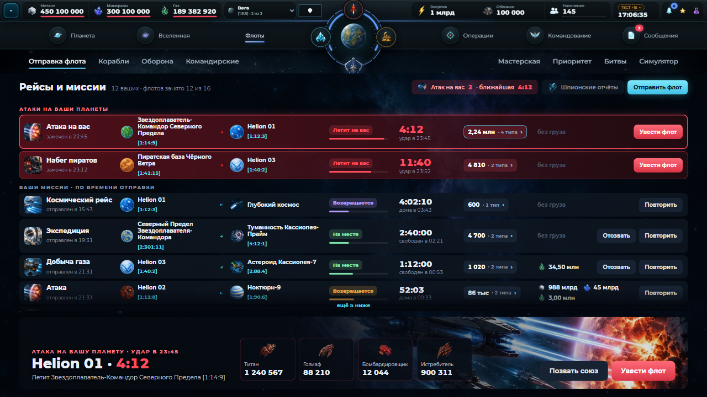
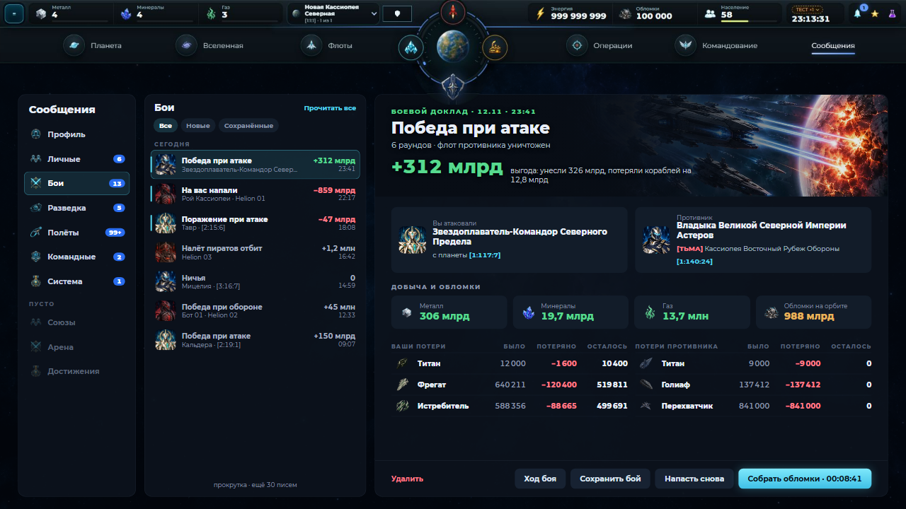
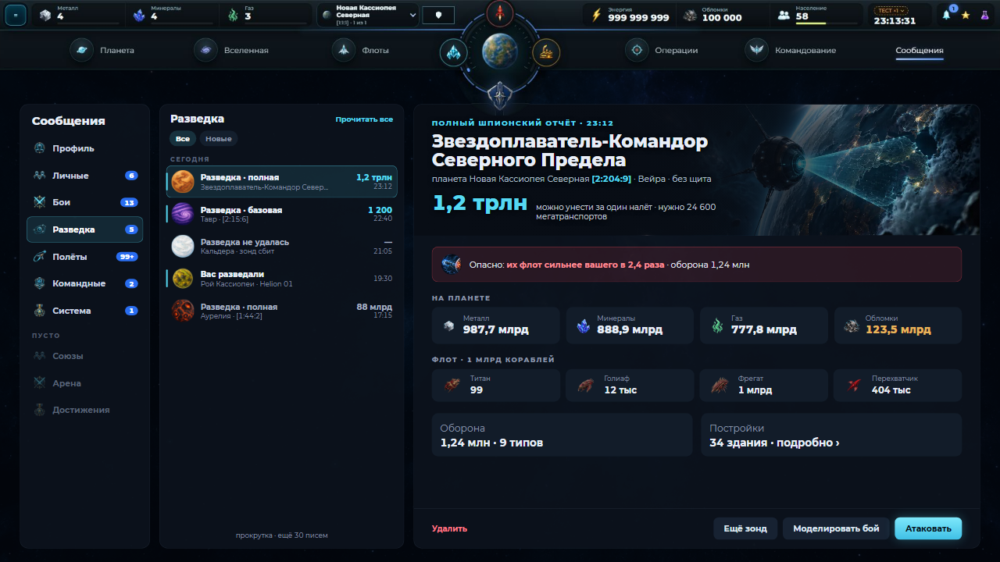
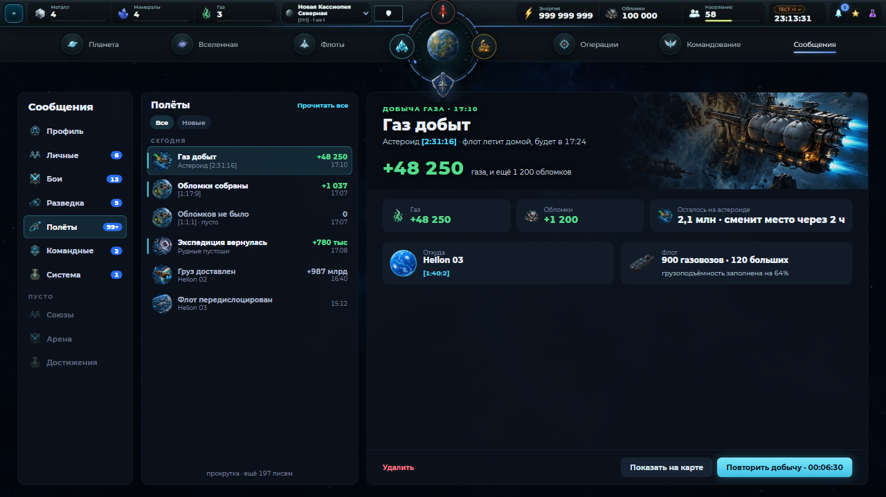
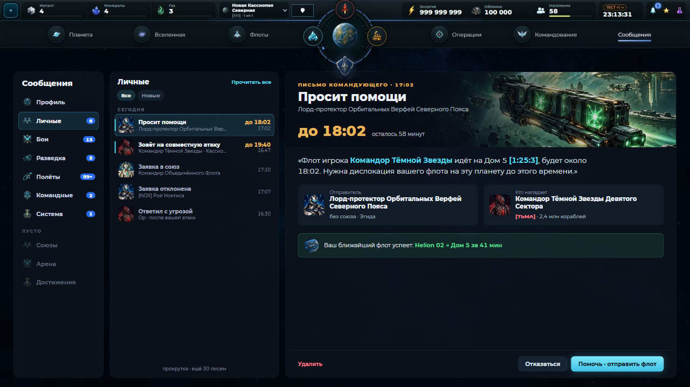
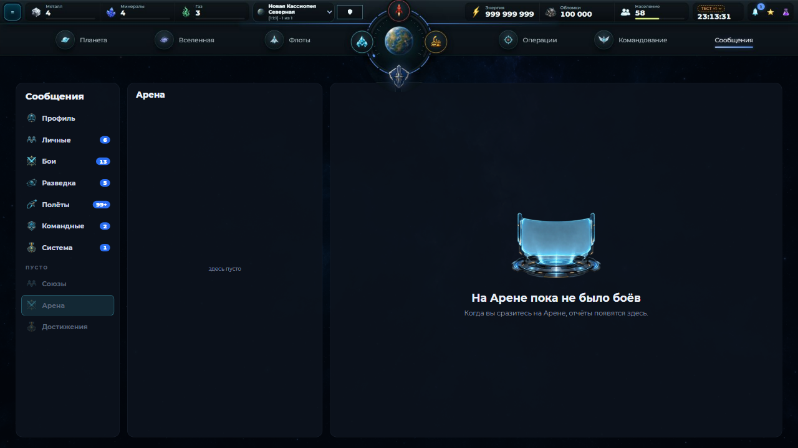

# Решения владельца по концептам v2 (12.11.2026)

Владелец выбрал **только два экрана**: «Флоты → Рейсы и миссии» и «Сообщения». Вселенная из этого цикла **не принята** ни в одном варианте (все раунды отклонены), её не трогать.

Правило владельца 12.11 по рейсам: «что на меня летит» смотрится нажатием на флот, как миссия, а не мелкими значками в строке.

Правило от владельца на этих экранах: **никакого белого текста на светлом арте**. Текст над артом всегда на тёмной подложке (градиент до ~65% ширины + тень текста). В макетах это уже исправлено.

Разрешение владельца: координатор может запустить ветку, чтобы перенести эти два концепта в игру. Старт после 23:00 (обновление лимитов) или сейчас, но следить за лимитами и перезапустить в 23:00.

## 1. Рейсы и миссии — `r5/flights.html`

- Место: Флоты → «Отправка флота», вместо выпадающего «Все рейсы ▾» под ним. Шапка и полоса разделов Флотов остаются как сейчас.
- Порядок: сверху блок **«Атаки на ваши планеты»** (красный, крупнее), ниже **«Ваши миссии» по времени отправки**.
- Одна строка = одна карточка: арт миссии (баннер), название и «отправлен в …»; откуда → куда (планета, имя, координаты; длинное имя переносится на 2 строки, не режется); «сейчас» (летит туда / на месте / возвращается / летит на вас) с полосой хода; сколько осталось и во сколько прибытие/возврат/удар; корабли — кнопка «2,24 млн · 4 типа ›» (без мелких картинок в строке); по нажатию внизу открывается полный состав, как миссия; груз (иконки ресурсов) или «без груза»; кнопки «Отозвать», «Повторить», у атак «Увести флот».
- Сверху справа: плашка «Атак на вас N · ближайшая mm:ss», «Шпионские отчёты», «Отправить флот».
- Внизу большая карточка выбранного рейса в стиле карточки миссии из «Отправки флота»: баннер миссии, крупный заголовок с таймером, **полный состав флота** (карточки: картинка корабля, название, точное число; больше 5 типов — «+N»), кнопки («Позвать союз», «Увести флот» для атаки; «Отозвать/Повторить» для своих).
- Пусто: картинка `empty-flights`, «Сейчас ни один флот не летит», кнопка «Отправить флот».
- Длинный список прокручивается внутри, без страниц.

## 2. Сообщения — `r5/mail.html?sec=battle|spy|flights|letters|empty`

| Бой | Разведка |
|---|---|
|  |  |
| Полёты | Письмо бота |
|  |  |

- Три колонки, как сейчас: разделы, список, отчёт; отчёту отдана большая часть ширины.
- **Разделы:** с письмами сверху со счётчиками; пустые внизу серыми под «ПУСТО».
- **Список:** без галочек и без страниц (прокрутка, «Прочитать все» сверху, фильтры «Все / Новые / Сохранённые»). Строка = картинка (портрет / планета / иконка миссии) + что случилось одной фразой («Победа при атаке», «На вас напали», «Газ добыт», «Просит помощи») + кто/где + справа одно число в цвете итога и время. Непрочитанные — полоса слева.
- **Отчёт:** сверху арт-шапка с видом отчёта и временем, заголовком и главным числом с расшифровкой:
  - бой: «+312 млрд» = унесли − потери; кто против кого (имя, союз, планета, координаты); добыча и обломки карточками; таблица потерь по типам у обеих сторон (было / потеряно / осталось); кнопки «Ход боя», «Сохранить бой», «Напасть снова», «Собрать обломки · время»;
  - разведка: «можно унести за налёт» + сколько нужно транспортов; красная плашка риска («их флот сильнее в N раз»); ресурсы, флот, оборона, постройки; «Ещё зонд», «Моделировать бой», «Атаковать»;
  - полёты: добыча крупно, что осталось на объекте, откуда и каким флотом; «Повторить добычу · время»;
  - письмо бота: срок ответа крупно, сама просьба, отправитель и нападающий, плашка «ваш ближайший флот успеет»; «Отказаться», «Помочь · отправить флот»;
  - пустой раздел: картинка и одна строка.
- Числа никогда не переносятся посреди цифр (короткая запись «987,7 млрд»).

## Чего нет в макетах (решить в PR)
- Разделы Профиль, Система, Командные, Союзы отдельно не рисовались: применить тот же каркас (арт-шапка + главное число + карточки).
- Числа в макетах условные (в моках разведки сумма ресурсов и «можно унести» не сведены).

Источники: снимки текущей игры `current/` (Actions run 43265172543), ответы владельца в сессии 12.11.
