# Pirate operations PR3 verification

Status: focused pirate-operation and relevant domain/application checks have passed. The broader `test:attack` suite still has the two previously observed target-resource assertions failing.

## Baseline

- Worktree: `codex/pr3-pirate-operations` at `a32e9cbdd664f54109c2d5d88c77961f00954c40`, matching `origin/main` and the specification checkpoint.
- Runtime: Node `v24.16.0`; npm `10.9.8`.
- Dependency setup: `npm ci` completed successfully (309 packages installed). npm reported 11 audit advisories (8 moderate, 3 high); no dependency files were changed.
- Baseline `npm run test:attack` on the starting checkpoint: **18 passed, 2 failed**, at `src/application/attack.test.ts`:381 and :407. These are the existing target-resource debit/live-resource expectations. The application suite later needed its two schema-version expectations updated for PR3's save schema bump; after that adjustment, `npm run test:application` passed **56/56**.
- The available Graphify snapshot under `D:\Desktop\Asterion\repo\src\graphify-out` is dated 2026-09-10 and describes unrelated building/UI code. It is stale for this worktree and is not evidence for the PR3 implementation.

## Implemented scenario

Production UI and application wiring were implemented by the feature agents. This verification note records QA evidence only; see `PR3_IMPLEMENTATION_REPORT.md` for the implementation inventory.

## State transitions and idempotency

Required acceptance rules are in `D:\Downloads\ASTERION_PR3_PIRATE_OPERATIONS_CODEX_PROMPT.md`, especially sections 3–7 and 10: one cycle key identifies one contact instance; recon and elimination snapshots stay bound to that cycle; reconciliation orders arrivals by logical arrival time; repeated dispatch/reconcile/reload must not duplicate flights, battles, reports, rewards, or contact defeat.

```mermaid
stateDiagram-v2
  [*] --> ContactActive: scheduled contact cycle
  ContactActive --> ReconOutbound: one probe dispatched
  ReconOutbound --> ReconReport: arrival while same cycle is active
  ReconOutbound --> ReturningNoTarget: cycle expired or defeated
  ReconReport --> Returning: report saved
  ReturningNoTarget --> Returning: exact no-target result saved
  ContactActive --> EliminationOutbound: combat fleet dispatched
  EliminationOutbound --> Battle: same cycle still active at logical arrival
  EliminationOutbound --> ReturningNoTarget: old cycle no longer active
  Battle --> ContactDefeated: full garrison eliminated
  Battle --> ContactActive: loss or draw; next mission gets fresh garrison
  ContactDefeated --> QuietPeriod: persisted defeat timestamp
  QuietPeriod --> ContactActive: next eligible scheduled cycle
```

Adapter, persistence, presentation, domain, and flight tests have passed as recorded below. Public elimination coverage exercises a full wipe and quiet window, commander loss/debris, same-time ID ordering with a second no-target arrival, a draw that preserves the contact, and multi-day reload/replay without duplicate battle or casualties. The focused combined result is **17 passed**.

## Integration test evidence

The user clarified that a successful recon report may reveal **ship composition and ship level only**. This clarification supersedes the attached prompt's applied-technology wording. Reports and feed text contain no applied technologies; normalization strips technology fields from legacy report payloads. Recon E2E covers deterministic success/failure, a frozen cycle snapshot, duplicate request handling, persistence hydration, and replay without duplicate reports. Adapter/persistence/presentation tests cover same-cycle in-flight/cooldown blocking, malformed snapshot isolation with reservation release, legacy missing pirate-state migration, stale recon and elimination messaging, and persisted return replay. The deterministic recon-domain test sampled 10,000 missions: **7,040/10,000 successes**, 95% Wilson interval **69.50%–71.29%**. The five public elimination tests cover win/defeat and quiet period, commander loss and debris, same-time ID tie-break/no-target, draw, and multi-day reload/replay.

## Commands and outcomes

| Command | Outcome |
| --- | --- |
| `npm ci` | Passed; 309 packages installed. |
| `npm run test:attack` | 18 passed, 2 resource assertion failures at `src/application/attack.test.ts`:381 and :426. They also failed on the starting checkpoint (then at :381 and :407). |
| `npm run test:pirate-operations` (rerun after recon-report clarification) | **17 passed**: 4 adapter, 4 persistence, 2 presentation, 2 public recon E2E, and 5 public elimination E2E. |
| `npm run test:pirates` (rerun after recon-report clarification) | 50 passed. |
| `npm run test:flights` | 98 passed. |
| `npm run test:application` | 56 passed after schema expectation update for PR3. |
| `npm run test:espionage` | 30 passed. |
| `npm run test:universe` | 37 passed, including pirate cycle projection/defeat scheduling. |
| `npm run test:reports` | 28 passed after adding the asset loader required by the pirate report adapter's PNG import. |
| `npm run test:rating` | 20 passed, including no Battle Points for both pirate PvE missions. |
| `npm run test:operations` | 13 passed. |
| `npm run test:combat` | 162 passed. |
| `npx tsc --noEmit --pretty false` (after recon-report clarification) | Passed with no diagnostics. |
| `git diff --check` (after recon-report clarification) | Passed with no whitespace diagnostics. |
| `npm run build` (final product sources) | Passed; Vite reported the existing large-chunk advisory. |
| `npm run test:universe-ui` | Passed at 1920×1080 and 1280×720, including both enabled pirate actions. |
| `npm run test:reports-ui` | Passed at 1920×1080 and 1280×720, including report reads, recycler arrivals, alliance update, persistence and deletion. |
| `npm run test:battle-reports-ui` | Passed. |
| `npm run test:space-flight-ui` | Passed at 1920×1080 and 1280×720. |
| `npm run test:production-test-isolation-ui` | Passed. |
| `node electron/pirate-operations-qa.cjs` (Electron E2E) | Passed at 1920×1080 and 390×844. Each viewport completed recon and elimination returns; no horizontal overflow, failed requests or load failures. The only console entries were Electron's development CSP warning. Recon dossier showed ship composition and ship level without pirate technologies. |
| `npm run dist:win` | Passed and produced `release/Asterion Setup 0.1.0.exe` (587,733,391 bytes). Packaging logged the existing large-chunk advisory, missing package description/author, a duplicate `@emnapi/runtime@1.11.3`, and the default Electron icon. |
| `npm run assets:asterion:audit` | Passed (intake 72, runtime 70). |

The 390×844 run retained the existing 1920×1080 stage scaled to fit. It had no clipping or horizontal overflow, but the text is small; the user explicitly chose to keep this behavior and document the limitation.

`test:attack` remains 18/20, with the same two resource assertions failing on the baseline commit. The final branch positions were :381 and :426 after test edits; this is recorded as a pre-existing failure, not a PR3 regression.

## Harness adjustment

`package.json`'s `test:reports` command registers `src/domain/combat/test-asset-loader.mjs`. Without it, the test runner fails while loading `assets/source/ships/pirates/ashfang.png`; with the loader, the exact npm command passes all 28 tests. The focused `test:pirate-operations` command lists adapter, persistence, presentation, recon integration, and elimination integration test files.

## Source checks

Fleet history labels `pirate-recon` as «Разведка пиратов» and maps it to the existing espionage mission icon in `src/FleetWorkspacePortal.tsx`:205,210. `pirate-elimination` is labeled «Уничтожение пиратов» and uses the existing mission asset at :119. TypeScript passes with these mappings present.
