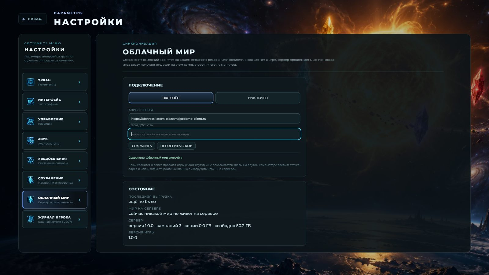
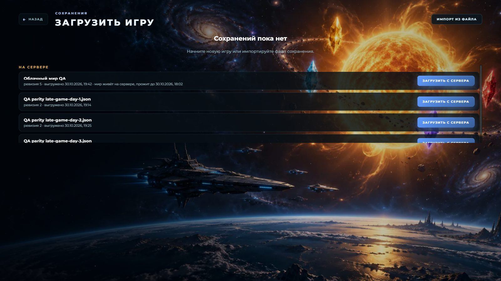
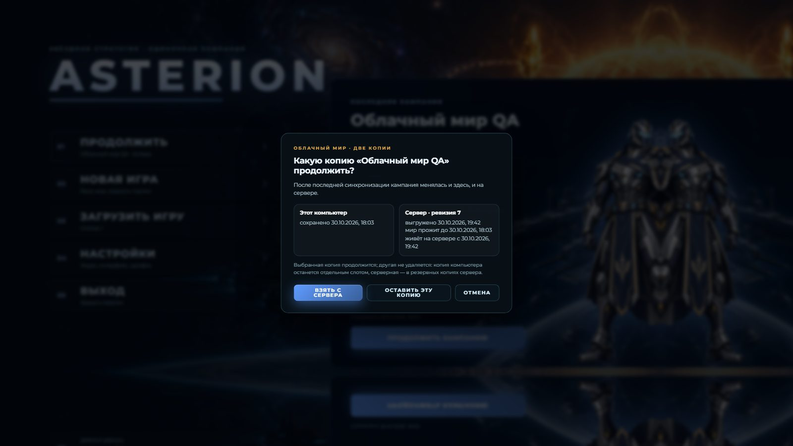

# Облачный мир — отчёт (30.10.2026)

Ветка `claude/cloud-catchup`. Сервер: `abstract-latent-blaze.majordomo-client.ru` (VPS-4-RU Lite,
2 vCPU AMD EPYC Rome, 4 ГБ RAM, 60 ГБ). Сырые цифры — `CLOUD_WORLD_2026-10-30.json` рядом.

## Коротко

- **Сервер развёрнут и работает:** `https://abstract-latent-blaze.majordomo-client.ru`, сертификат Let's
  Encrypt, доступ по ключу, ufw/fail2ban, SSH только по ключу, самообновление из GitHub Releases.
  Ключ уже лежит в профиле установленной игры на этом компьютере (заработает после мержа и
  автообновления игры).
- **Эстафета:** в игре мир считает игра; вышел — сервер держит мир живым (шаг каждые 10 с, отставание
  ≤ 1–2 с); вернулся — «Получаем мир с сервера…», и мир применяется за **5,6 с на мире дня 2 и 7,5 с
  на мире дня 3** (от клика до игры). Локально то же отсутствие длиной 22 ч заняло бы ~40 и ~60 минут.
- **Качество не теряется:** мир, прожитый сервером, **побайтно равен** локальному прогону той же длины
  от того же сохранения — проверено на реальном сервере на мирах дней 1, 2 и 3, в unit-тесте на
  полном мире с неровными шагами и в CI. После обновления сервера посреди живого мира — равен после
  загрузки (так игра читает любое сохранение).
- **Цена живого мира на сервере:** день 1 — 2,4% одного ядра и 0,54 ГБ, день 2 — 5% и 0,74 ГБ, день 3 —
  9% и 0,8–0,9 ГБ. Оценка дня 7: ~20–25% ядра, ~1,5 ГБ (пик при записи ~2,5 ГБ) — помещается в 4 ГБ.
- **Никогда не теряется прогресс:** офлайн, недоступный сервер, неверный ключ, другая версия,
  локальное новее — старый локальный путь; изменились обе копии — выбор с датами, вторая копия
  сохраняется (слот или резервная копия сервера). Всё это проверено Electron QA на реальном сервере.
- **Несколько ПК:** «Настройки → Облачный мир» (адрес, ключ) и «Загрузить игру → На сервере».
- **Резервные копии:** каждая ревизия и каждый неприменённый мир сервера; ротация 40 снимков на кампанию,
  ≤ 30 ГБ, ≥ 10 ГБ свободного места.

## Как это устроено: эстафета

В каждый момент мир двигает только одна сторона.

1. **Игрок в игре — мир считает игра**, как раньше. Сервер этот мир не трогает. Раз в 12 минут игра
   отправляет на сервер копию сохранения (резервная копия; сервер её не «оживляет»).
2. **Игрок вышел** («В главное меню» или закрыл окно) — игра отправляет ровно тот текст сохранения,
   который лежит на диске, с пометкой «игрок вышел», версией игры, номером слота и ревизией, от
   которой это сохранение продолжается. Сжатие (gzip) и сеть — в главном процессе Electron, без
   фризов. Закрытие окна ждёт сжатия и **не больше 2,5 с** сети; не успело — остаётся прошлая
   выгрузка и обычный локальный путь (QA: при недоступном сервере окно закрывается за 0,04–0,6 с).
3. **Сервер держит мир живым.** Получив сохранение «игрок вышел», он поднимает отдельный процесс —
   раннер мира — из релиза той же версии игры. Раннер загружает сохранение тем же
   `loadSavedState`, что и игра, и каждые 10 с продвигает мир тем же `reconcileRuntime`
   (`src/application/npc-live-world.ts`: цель прогона двигается вместе с часами, сводка «пока вас
   не было» остаётся открытой). Раз в 10 минут — контрольная точка на диск.
4. **Игрок вернулся.** При «Продолжить»/«Загрузить» игра сначала спрашивает сервер («Получаем мир с
   сервера…»). Если серверный мир продолжает **ровно то сохранение, что лежит на этом компьютере**
   (sha256 локального текста совпадает с тем, что было выгружено), и мир прожит **той же версией
   игры** — сервер останавливает раннер, сохраняет прожитый мир новой ревизией и отдаёт его; игра
   записывает его вместо локального и входит. Остаток (секунды) досчитывается локально как обычно.
   С этого момента мир снова считает игра.
5. **Иначе — старый локальный путь**, без потерь:

| Ситуация | Что делает игра |
|---|---|
| сервер недоступен / офлайн / таймаут | играет локальное сохранение, сообщение «Нет связи с сервером…» |
| неверный ключ | локально, «Сервер не принял ключ доступа…» |
| мир на сервере прожит другой версией игры | локально досчитывает сама; серверный мир останавливается и остаётся резервной копией |
| на этом ПК сохранение новее (играли офлайн) | локально; серверный мир останавливается (резервная копия), следующая выгрузка заменяет его |
| кампании нет на сервере | локально; при выходе она выгрузится |
| копия на сервере создана более новой схемой сохранения | локально |
| **изменились обе копии** / этот ПК ещё не синхронизировал кампанию / сервер «отстал» / кампания открыта на другом ПК | **диалог с датами**: «Взять с сервера» (копия этого ПК сохраняется отдельным слотом «… (копия)») / «Оставить эту копию» (серверная остаётся резервной) / «Отмена» |

Правила — `src/application/cloud/cloud-sync.ts` (`decideCloudEntry`), тесты — `cloud-sync.test.ts`.
Мир с чужой ревизии не применяется никогда: выгрузка, не продолжающая последнюю ревизию сервера,
отклоняется (409), а взять живой мир можно только от той ревизии, на которой он живёт.

### Несколько компьютеров

Ревизии одной кампании образуют одну линию. Каждый компьютер помнит (`cloud-sync.json`), какой
ревизии сервера равно его локальное сохранение. На втором компьютере: «Настройки → Облачный мир» —
тот же адрес и ключ; «Загрузить игру → На сервере» — кампании, которых здесь нет; «Загрузить с
сервера» создаёт слот с тем же id и входит в серверный мир. Дальше эстафета та же.

### Версии и обновление сервера

- Сервер считает тем же кодом: `npm run build:server` собирает `server/src/server.ts` (HTTP) и
  `server/src/runner.ts` (мир) вместе с кодом игры (`src/application/…`) в два файла без
  `node_modules`. Job `release` публикует `asterion-server-X.Y.Z.tgz` в каждом релизе.
- `asterion-update.timer` раз в 30 минут (и `asterion-update.path` сразу, когда игра новой версии
  выгружает мир) смотрит последний релиз GitHub (репозиторий публичный, без токена), проверяет
  sha256, ставит бандл в `/opt/asterion/releases/X.Y.Z`, переключает `current` и перезапускает службу.
- **Как не испортить живой мир при обновлении — держим версии рядом.** Мир досчитывается раннером
  того релиза, в котором игрок его оставил: при остановке службы раннер пишет контрольную точку, после
  запуска новый сервер поднимает раннер **старой** версии (её каталог не удаляется, пока хоть один
  мир в ней живёт; кроме того, хранятся 3 последних релиза). Почему так, а не иначе:
  - остановить мир до входа клиента той же версии — теряется время жизни мира ровно тогда, когда
    обновление вышло, а игрок не играет;
  - мигрировать живой мир новым кодом — мир получился бы смесью двух версий, а побайтное равенство с
    локальным прогоном перестало бы что-либо значить.
  Игра обновилась раньше, чем сервер, — мир новой версии ждёт обновления сервера (статус
  `waiting-version`, обновление запускается сразу), а вошедший игрок досчитывает локально.
  Игра новой версии не берёт мир, прожитый старой: досчитывает сама, серверный мир становится
  резервной копией.

## Качество решений NPC не теряется

Мир, прожитый сервером, **побайтно равен** локальному прогону той же длины от того же сохранения
(sha256 сериализованного сохранения):

| Мир | Сервер прожил | Забрать мир с сервера | Локальный прогон того же | sha256 |
|---|---|---|---|---|
| день 1 (18,9 млн символов) | 13 игровых минут | 2,1 с, 1,8 МБ | 10,8 с | **совпадает** |
| день 2 (39,9 млн) | 40 мин (30 из них — догонка после выгрузки) | 4,6 с, 4,1 МБ | 89 с | **совпадает** |
| день 3 (57,8 млн) | 40 мин | 3,4 с, 6,0 МБ | 114 с | **совпадает** |
| день 1, сервер **обновлён посреди** живого мира | 9 мин | 1,3 с | 7,6 с | совпадает после загрузки |

(`npm run cloud:parity`, реальный сервер, 30.10.2026; часы сервера для фикстур сдвинуты на время мира
заголовком смещения часов, как часы страницы в QA.)

- `src/application/npc-live-world.test.ts` (в `test:npc`): полный мир (10 галактик, 100 NPC), 90
  игровых минут неровными шагами 5 с — 11 мин против одного прогона `runNpcCatchup`; плюс рестарт
  сервера посередине (сохранение → загрузка → продолжение).
- `server/src/server.test.ts` (в `test:cloud`, CI): настоящий сервер на localhost, мир живёт,
  забирается и сверяется с локальным прогоном.
- `npm run cloud:parity -- --fixture=…` — то же на реальном сервере с поздними мирами.

## Цифры

### Вход: с сервером против локального прогона (Electron, реальный сервер)

От клика «Продолжить» до игры на экране. Сервер держал мир 5 минут; для сравнения на «другом
компьютере» без облака то же сохранение досчитывалось игрой само.

| Мир | С сервера | из них облако | отставание после входа | Локально 5,5 мин отсутствия | Локально 22 ч (по скорости прогона) |
|---|---|---|---|---|---|
| день 2 | **5,6 с** | 3,3 с | 3,3 с | 13,1 с | ~40 мин |
| день 3 | **7,5 с** | 4,4 с | 4,5 с | 21,5 с | ~60 мин |
| маленький мир | 6,0 с | | 1 с | | |

С сервером время входа не зависит от длины отсутствия: сутки, неделя — те же секунды (плюс рост
сохранения). Без сервера оно растёт линейно: день 7 — ~2,5 ч на сутки отсутствия.
Сеть этого ПК идёт через локальный прокси (~0,5 с на запрос) — это часть «облако».

Выгрузка при выходе (в фоне): день 2 — 1,8 с (4,1 МБ), день 3 — 3,4 с (6,1 МБ). Закрытие окна при
недоступном сервере: маленький мир — 0,03–0,6 с, мир дня 2 — 1,5–2,7 с (сжатие + отказ соединения).

### Цена живого мира на сервере (2 vCPU EPYC Rome)

| Мир | CPU в установившемся режиме (шаг 10 с) | RAM раннера | Догонка после выгрузки |
|---|---|---|---|
| день 1 | ~0,24 с на шаг — **2,4% одного ядра** | 0,54 ГБ | 10 мин мира за ~30 с |
| день 2 | ~0,5 с — **5%** | 0,74 ГБ (служба целиком — пик 0,79 ГБ) | 30 мин за ~2 мин |
| день 3 | ~0,93 с — **9%** | 0,80–0,88 ГБ | 30 мин за ~3 мин |
| день 7 (оценка) | ~2–2,5 с — **20–25%** | ~1,5 ГБ, пик при записи мира ~2,3–2,5 ГБ | |

Сервер (служба без мира) — 85 МБ. Одно ядро EPYC VPS считает мир в ~1,7 раза медленнее Ryzen 5 5600,
но живой мир идёт малыми шагами и использует десятую часть ядра на дне 3. Оценка дня 7 — по тренду
дней 1–3 (+0,35 с на шаг и +~0,17 ГБ на игровой день) и по прогону в Node из отчёта #116 (~380 с на
игровой час на дне 7, на сервере ×1,7): в 4 ГБ (лимит службы 3 ГБ + swap 2 ГБ) помещается с запасом
~0,5 ГБ. Если поздние миры перерастут, можно поднять `--max-old-space-size` раннера до 2700.

### Шаг живого мира

Каждые 10 с, бюджет одного шага 4 с; отставающий мир (после выгрузки посреди прогона или после
рестарта) догоняется подряд, потом снова шаги по 10 с. Отставание в установившемся режиме — 0–1 с.
Контрольная точка — раз в 10 минут (день 3 — 0,6 с записи) и при остановке службы.

## Резервные копии и место

- Каждая выгрузка и каждый мир, отданный сервером, — ревизия (`snap-N.json.gz`, точный текст
  сохранения). Живой мир, который игрок не взял (играл офлайн, другая версия), и голова, заменённая
  по выбору игрока, — резервные копии. Всё видно в `GET /v1/campaigns/<slot>`.
- Ротация: не больше 40 снимков на кампанию; всего не больше 30 ГБ; на диске всегда свободно
  ≥ 10 ГБ (из 60). Голова и основа живого мира не удаляются никогда. Мир дня 3 — 6,2 МБ в gzip,
  то есть 40 снимков поздней кампании ≈ 0,25–1 ГБ.

## Безопасность

- HTTPS: Caddy, сертификат Let's Encrypt выдан (`CN=YE1`, до 28.01.2027), продлевается сам.
- Доступ — по ключу, который сгенерировал сервер (`/etc/asterion/access-key`, 64 символа). В логи
  не пишется ни сервером (только «auth failed from <ip>»), ни Caddy (заголовок Authorization он
  маскирует). У владельца ключ лежит в `%APPDATA%\Asterion\cloud-key.txt`, в репозитории его нет.
- 10 неверных ключей с одного адреса за 10 минут — блок на 15 минут в самом сервере и бан fail2ban
  (jail `asterion`) на час; общий лимит — 60 запросов в минуту с адреса. Загрузка ≤ 170 МБ (Caddy) /
  160 МБ gzip и 900 МБ распакованного текста (сервер).
- ufw: открыты только 22, 80 (ACME) и 443. SSH только по ключу (`PasswordAuthentication no`,
  `PermitRootLogin prohibit-password`) — отключено после проверки входа по ключу и проверено снова
  после; вход паролем теперь получает `Permission denied (publickey)`. fail2ban (`sshd`, `asterion`),
  unattended-upgrades включены.
- Служба `asterion`: пользователь `asterion` без шелла, `MemoryMax=3G`, `MemoryHigh=2800M`, swap-файл
  2 ГБ (`vm.swappiness=10`), `Nice=10`, `CPUWeight=50`, `ProtectSystem=strict`, писать можно только в
  `/var/lib/asterion`. Раннер мира — `--max-old-space-size=2300`.

## Что где лежит

На сервере — таблица в `server/deploy/README.md`. В репозитории:

| Файл | Что |
|---|---|
| `src/application/npc-live-world.ts` | живой мир: шаг, открытая сводка, возврат игроку |
| `src/application/cloud/cloud-sync.ts` | правила входа: применить / локально / спросить |
| `server/src/server.ts`, `store.ts`, `runner.ts` | сервер, ревизии и ротация, раннер мира |
| `electron/cloud.cjs`, `electron/preload.cjs` | сеть, сжатие, ключ и записи синхронизации в главном процессе |
| `src/ui/menu/cloud.ts`, `CloudMenu.tsx`, `CloudSettingsPanel.tsx` | вход, выгрузки, баннер, выбор, настройки |
| `server/deploy/*` | развёртывание, systemd, Caddy, fail2ban, самообновление |
| `electron/cloud-world-qa.cjs` | Electron QA (локальный мок в CI, `--server-url` — реальный сервер) |
| `tools/cloud-parity.mjs` | сверка «сервер = локально» на реальном сервере |

На компьютере игрока (`%APPDATA%\Asterion`): `cloud.json` (адрес, вкл/выкл, id компьютера),
`cloud-key.txt` (ключ), `cloud-sync.json` (какой ревизии равна каждая локальная кампания, последняя
выгрузка и ошибка).

## Как включить

**Этот компьютер.** Уже включено: развёртывание положило адрес и ключ в профиль установленной игры.
Установленная 1.0.1 облака ещё не знает; после мержа этого PR игра обновится и сразу начнёт работать
с сервером. Проверить: «Настройки → Облачный мир» — «Сервер: версия …», «Последняя выгрузка».

**Второй компьютер / переустановка.** Установить игру → «Настройки → Облачный мир» → адрес
`abstract-latent-blaze.majordomo-client.ru`, ключ (взять: `ssh asterion-vps cat /etc/asterion/access-key`
или файл `%APPDATA%\Asterion\cloud-key.txt` с этого ПК) → «Включён» → «Проверить связь» →
«Загрузить игру» → «На сервере» → «Загрузить с сервера».

## Проверки

| Проверка | Результат |
|---|---|
| `npm run build`, `npx tsc --noEmit`, `npm run build:server` | проходят |
| `test:inventory` | 153 файла, 0 пропущено |
| `test:cloud` (новый, в CI): протокол, ключ и блокировка, ревизии, 409, резервные копии, ротация, рестарт посреди живого мира, «сервер = локально», правила входа | 15/15 |
| логические наборы CI (application, new-game, buildings, combat, flights, attack, pirates, pirate-operations, exploration, sun-raid, espionage, repair, fleet, universe, reports, rating, command, science, settings, runtime, release, resources, energy, operations) | все зелёные |
| `test:npc` (с новым `npc-live-world.test.ts`) | 177/177 (2 пропуска — 30-дневные горизонты, они в main/nightly) |
| `test:cloud-world-ui` (новый, в CI, шард campaign-command): все сценарии против локального сервера | проходит |
| то же против **реального сервера** (`--server-url`) | проходит (маленький мир — все сценарии; миры дней 2 и 3 — эстафета и замер) |
| `qa:visual` | проходит |
| `test:new-game-ui`, `test:save-store-ui`, `test:save-safety-ui` | проходят |
| `test:late-save-ui` (фикстуры дней 2–3) | проходит |

Сценарии Electron QA (`electron/cloud-world-qa.cjs`): настройки «Облачный мир» вводятся в меню и
«Проверить связь» показывает версию сервера; кампания, которой нет на сервере, открывается локально, а
выход в меню отдаёт мир серверу; сервер живёт N минут; «Продолжить» — баннер «Получаем мир с сервера…»,
мир сервера применён, отставание от часов < 1 с; другая версия игры — локально, серверный мир
остановлен и сохранён резервной копией; сервер недоступен — вход за 0,2 с, закрытие окна за 0,04–0,6 с;
локально новее — локально, выгрузка заменяет серверную копию; второй ПК без сохранения — «На сервере» →
кампания открыта; обе копии изменились — диалог с датами, «Взять с сервера», копия ПК осталась
слотом «… (копия)»; неверный ключ — локально с причиной; ключ не попал в лог сервера.

Скриншоты прогона на реальном сервере:

(В QA часы игры сдвинуты на время мира, поэтому «выгружено» и «прожит до» на снимке расходятся.)

## Ограничения

- **Закрытие окна на медленном канале.** Окно ждёт сжатия (мир дня 3 — ~0,7 с) и не больше
  2,5 с сети. Мир дня 3 — 6 МБ: при исходящем канале медленнее ~20 Мбит/с выгрузка при закрытии может
  не успеть. Тогда сервер мир не оживляет, а при следующем входе игра досчитывает отсутствие сама (как
  до этого PR) — ничего не теряется. Выход через «В главное меню» такого ограничения не имеет: окно не
  закрывается, выгрузка идёт в фоне.
- **Сервер медленнее этого ПК.** На одном ядре EPYC Rome VPS мир считается в ~1,6–2 раза медленнее,
  чем на Ryzen 5 5600. На «живой» мир это не влияет (он считается малыми шагами с запасом), но если
  игрок вышел посреди долгого прогона, сервер досчитывает его медленнее, чем сделал бы ПК.
- **Один живой мир.** Выход из второй кампании завершает живой мир первой в ревизию (её прогресс
  сохраняется; при входе в первую игра заберёт эту ревизию и досчитает остаток сама).
- **День 7 не измерен** — мира дня 7 нет (его генерация занимает часы). Оценка выше — по тренду дней 1–3.
- **Разные версии.** Мир, прожитый одной версией, не применяется в другой — сразу после обновления
  игры первый вход досчитывает отсутствие локально (если сервер ещё не обновился, он получит новый
  бандл через `asterion-update.path` за минуты).
- **Часы.** Сервер живёт по своим часам (NTP). Если часы ПК сильно отстают, применённый мир может быть
  «впереди» на эту разницу — игра просто ждёт, пока её часы догонят.
- **Установленная 1.0.1** облака не знает: всё заработает после мержа и автообновления игры.
- Онлайн-игра с командами через сервер и Telegram-уведомления не делались (по задаче не нужны).
- Сжатие архивов и сокращение хранения отчётов — следующий PR.
