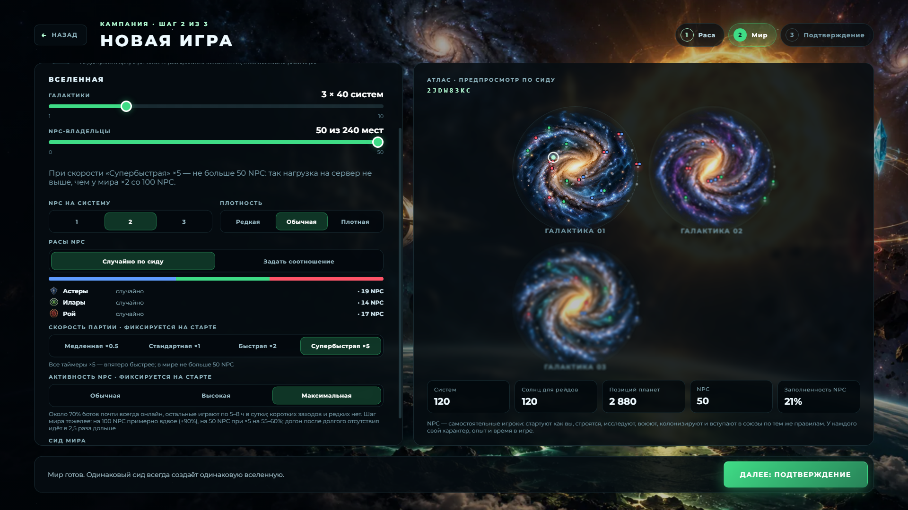
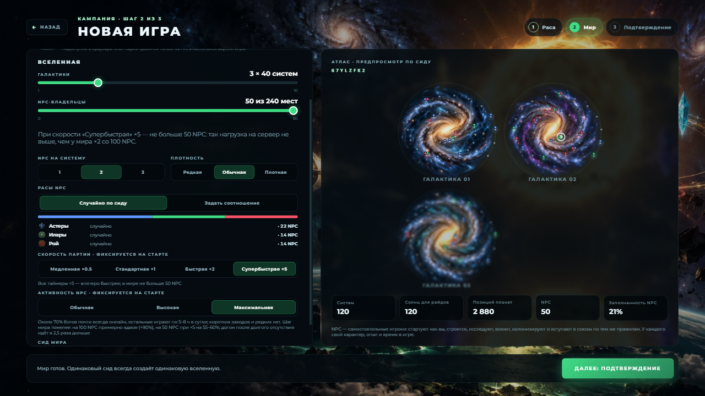

# Настройка «Активность NPC» в мастере новой игры (02.11.2026)

Решение владельца: «если я выбираю супербыстрое, 50 ботов, на 5x, хочу выставить максимальный коэффициент активности, чтобы минимально было неактивных ботов».

## Что сделано

- `NewGameConfig.world.npcActivity?: 'normal' | 'high' | 'max'` (`src/domain/world/config.ts`). Поля нет в старых сохранениях и сериях: оно читается как `'normal'` (`npcActivityOf`), нормализация старый конфиг не переписывает.
- Как устроена активность: у каждого NPC скрытая `propensity` 0…1. `stratifyNpcPopulation` (`state.ts`) раздаёт её ровно по слотам в скрытом порядке; `npcOnlineMinutesPerDay` (`calendar.ts`) превращает её в минуты онлайна в сутки, класс определяется диапазоном. Классы владельца: 0.71–1 → 12–16 ч, 0.36–0.70 → 5–8 ч, 0.11–0.35 → 2–3 ч, до 0.1 → ~1 ч (пол 0.2, решение 31.10, лишает «редких» мёртвого бота).
- Новая настройка меняет только отображение слота в propensity (`shapeNpcActivity` в `calendar.ts`): порядок ботов не меняется, «обычная» — тождество (байт в байт как на main). Диапазон каждого класса заполняется линейно, поэтому внутри смеси боты разные.
  - «Высокая»: 15% → 0.20–0.35, 40% → 0.36–0.70, 45% → 0.71–1.
  - «Максимальная»: 30% → 0.36–0.70, 70% → 0.71–1.
- Значение попадает в сам профиль NPC при создании мира (`createNpcState`, `respreadNpcPopulation`), поэтому облачный сервер читает его из сохранения и не знает ни о каком поле. Серии: `bindNewCampaignToSeries` берёт уровень из `worldConfig`, а «Продолжить серию» берёт его из прошлого раунда вместе с остальными настройками мира.
- Навык (`mechanicsKnowledge`) не тронут: в тесте порядок и навык одинаковы при любом уровне. Стартовый рывок (день 1 ×2, день 2 ×1,5) остался.
- Мастер: выбор из трёх вариантов под «Скоростью партии», подсказка меняется с выбором, строка «Активность NPC» на шаге подтверждения. Карточка слота в «Загрузке» показывает уровень (`SaveSlotMeta.npcActivity`, необязательное поле).

## Доли и часы онлайна (замер)

`node --experimental-strip-types tools/npc-activity-quantiles.mjs`: 4 соли мира, 28 суток, обычные дни (с 4-го), часы онлайна в сутки по владельцу.

| NPC | Уровень | q05 | q10 | q25 | q50 | q75 | q90 | q95 | среднее | ≥10 ч | 4–10 ч | 1,5–4 ч |
|---|---|---|---|---|---|---|---|---|---|---|---|---|
| 50 | обычная | 2,2 | 2,3 | 2,5 | 5,9 | 10,7 | 12,4 | 12,7 | 6,5 | 27% | 38% | 35% |
| 50 | высокая | 2,5 | 2,7 | 5,6 | 7,5 | 12,0 | 12,6 | 12,8 | 8,3 | 43% | 42% | 14% |
| 50 | максимальная | 5,3 | 5,8 | 7,4 | 11,6 | 12,4 | 12,7 | 12,9 | 10,2 | 67% | 33% | 1% |
| 100 | обычная | 2,2 | 2,3 | 2,5 | 6,0 | 10,3 | 12,4 | 12,7 | 6,5 | 27% | 37% | 36% |
| 100 | высокая | 2,4 | 2,7 | 5,4 | 7,5 | 11,9 | 12,6 | 12,8 | 8,1 | 41% | 43% | 15% |
| 100 | максимальная | 5,1 | 5,6 | 7,3 | 11,4 | 12,3 | 12,7 | 12,9 | 10,1 | 64% | 36% | 0% |

Расхождение с 30/35/25/10 и 45/40/15 и 70/30 небольшое, и оно в календаре, а не в смеси: верхний класс упирается в потолок 95% от 16-часового окна и множитель дня (в среднем ~12,7 ч), поэтому «≥10 ч» чуть ниже целевой доли. «Редкие ~1 ч» в обычной смеси сейчас играют по ~2,3 ч из-за пола 0.2 (решение 31.10); этого я не менял. Минимум в «Максимальной» — 3,6–4 ч в отдельный день, по среднему — не менее 5 ч.

Средний онлайн по дням (часы на одного NPC) на старте: день 1 / 2 / 3 — обычная 9,4 / 7,8 / 6,7; высокая 11,1 / 9,6 / 8,4; максимальная 12,6 / 11,3 / 10,4.

## Нагрузка (GitHub Actions, run 41476803024)

`bot-lab.yml`, новый вход `activity_cpu` (и `fixtures_run` для готовых фикстур): мир дня 3 строится для каждого уровня, затем по 3 прохода по очереди на одном раннере, `live-world-bench.mjs`, шаг в 60 с игрового времени, 120 шагов; ниже — медиана из трёх проходов. Решения NPC не упрощались.

| Мир | Уровень | Медиана шага | p95 шага | к «Обычной» (медиана / p95) |
|---|---|---|---|---|
| 100 NPC, ×1 | обычная | 982 мс | 1452 мс | — |
| 100 NPC, ×1 | высокая | 1299 мс | 1743 мс | +32% / +20% |
| 100 NPC, ×1 | максимальная | 1875 мс | 2492 мс | **+91% / +72%** |
| 50 NPC, ×5 | обычная | 542 мс | 777 мс | — |
| 50 NPC, ×5 | высокая | 660 мс | 962 мс | +22% / +24% |
| 50 NPC, ×5 | максимальная | 850 мс | 1236 мс | **+57% / +59%** |

«Максимальная» на 100 NPC даёт больше +50% к шагу, поэтому это написано в подсказке мастера. Для живого мира цена в процентах от реального времени невелика (1,9 с шага на 60 с = ~3% одного ядра), для 50 NPC при ×5 — 0,85 с на 60 с.

Догон после отсутствия (генерация мира дня 3 = 72 игровых часа, время задания целиком, 2 vCPU):

| NPC | обычная | высокая | максимальная |
|---|---|---|---|
| 100 | 2 ч 9 мин | 3 ч 26 мин | 5 ч 18 мин (×2,5) |
| 50 | 33 мин | 28 мин | 56 мин (×1,7) |

Максимальный мир на 100 NPC догоняется ~×13,6 к реальному времени, обычный — ~×33. Живому миру на сервере нужно ×1, запас остаётся, но долгий догон у «Максимальной» тяжелее: и сам мир активнее, и больше построено. Часть разницы — не активность как таковая, а более развитый мир к 3-му дню. Генерация 50-NPC «высокая» (28 мин) вышла быстрее «обычной» (33 мин): шум раннера, эта строка ничего не доказывает.

## Проверки

- Тесты: `src/domain/npc/activity-level.test.ts` (доли, монотонность, порядок, навык, конфиг), `src/application/npc-activity-setting.test.ts` (мир `'max'` совпадает побайтно при любой нарезке и после перезагрузки; без поля = создание main).
- `npx tsc --noEmit`, `npm run build`, `test:inventory`, `test:npc`, `test:new-game`, `test:cloud`, `test:new-game-ui` — зелёные.
- Мастер при 1920×1080 и 1280×720 (реальная игра, Electron QA, режим «Максимальная» при скорости ×5):

## Что осталось

- Шкала нагрузки на ПК владельца не снималась (замер только на раннере GitHub, 2 vCPU).
- Сервер читает уровень из сохранения профилей; отдельной проверки облака на `'max'` нет, кроме общих тестов сохранения.
