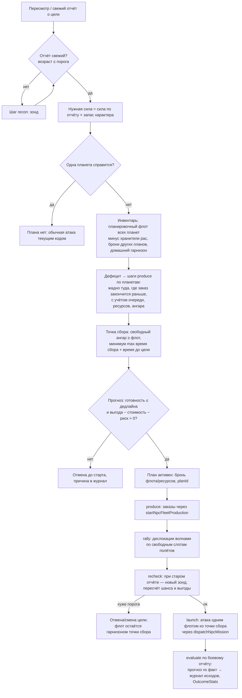

# «Максимально умные NPC» — этап A: аудит и архитектурное решение (ADR)

**Дата:** 31.10.2026 · **База:** `main` 2acb2a3 (1.3.0, после PR 10 / #122 «боты играют лучше») · **Ветка:** `claude/npc-intelligence`
**Входные документы:** видение владельца `docs/research/ASTERION_NPC_STRATEGIC_INTELLIGENCE_VISION_AUDIT_2026-10-31.md`
(далее — «видение»), отчёт PR 10 `docs/reports/BOTS_SMARTER_2026-10-31.md`, код по карте раздела 10.2 видения.
**Статус:** проект и план. Код игры не менялся. Решения — за владельцем (вопросы в разделе 11).

Маркировка: **[ФАКТ]** — проверено в коде main (файл и функция/строка указаны); **[ГИПОТЕЗА]** — инженерная оценка, требует
замера; **[НЕИЗВЕСТНО]** — не нашёл в коде, не додумываю; **[РЕШЕНИЕ]** — нужен выбор владельца.

---

## 0. Резюме для владельца (одна страница)

**Что есть сейчас.** У каждого из 100 NPC уже есть скрытый характер (14 черт), память, цели, календарь визитов,
обиды на обидчиков, стили игры из PR 10. Но «память» сегодня — это в основном список «я начал действие / мне
отказали», а не «что из этого вышло». Цели пересматриваются, но это одно слово («экономика», «атака»), а не план.
Каждое решение — взвешенный жребий из того, что можно сделать прямо сейчас на этом экране. Поэтому боты выглядят
живыми, но **не доводят до конца многошаговых замыслов**, и именно это вы назвали «не хватает разума».

**Что я нашёл неожиданного (важно для решений):**
1. **Новой «серии раундов» в игре нет.** После Врат — окно «Победа/Поражение» с кнопками «Остаться», «Новая игра»,
   «Главное меню». «Новая игра» — это чистый мир: характеры NPC заново выпадают из случайной соли, а `npc-gen-23`
   в новой игре — **другой** бот с тем же номером. Перенос личности (ваш «ID 23») придётся проектировать с нуля.
2. **Игроку уже разрешено возить ресурсы кому угодно** — своим, союзникам, нейтралам и даже врагам (что не влезло
   в склад — сгорает). **NPC возят только на свои планеты** и союзникам по заявке помощи. То есть «друг, нужны
   ресурсы?» вне союза для NPC — не новое правило, а выравнивание с игроком.
3. **Одиночки (без союза) для всех — «нейтралы»**, войны бывают только между союзами. Договор двух соло-NPC сегодня
   нигде не записывается и ни на что не влияет.
4. **Ошибка в обучении:** победа в бою записывается в память как `battle-victory`, а выбор атак ищет `battle-win` —
   победы атак не учитываются вообще, учитываются только поражения. Плюс боевые воспоминания вытесняются за
   2–3 взгляда на игру (лимит 64 записи, а один взгляд пишет до 24 «я начал/мне отказали»).
5. **Атака всегда идёт с одной планеты.** Дислокацию боты используют только для защиты (до 3 источников). Сборки
   флота «семь планет → точка сбора → один удар» нет ни в каком виде — ваша догадка верна.
6. Солнце: лидер выбирает систему для рейда **случайно из 6**, без разведки и подготовки; объявляет, только если
   нужная сила уже онлайн.

**Что предлагаю.** Не переписывать ботов и не подключать нейросеть/LLM к игре. Сверху над существующим выбором
действий добавить три вещи, по одной за PR, каждую с замером «до/после» в лаборатории:
- **журнал исходов для всех 100 NPC** («что ожидал → что получил»), компактный, вне сохранения;
- **исполнимые планы** — сначала один: «разведка → флот на нескольких планетах → дислокация в точку сбора →
  перепроверка → удар или обоснованная отмена»; план живёт в сохранении, переживает выход из игры;
- **социальная память** (кто помог, кто подвёл, кто грабит) и договоры NPC↔NPC; затем — подготовка Солнца заранее;
  затем — личности между раундами (когда вы решите, что такое «новый раунд»).

**Первый шаг, который можно начинать сразу после вашего «да»:** PR «журнал исходов + план удара» (≈ 35–46 часов
работы сессии). Критерий: в лабораторном мире видно, как бот заказывает корабли на 3+ планетах, сводит их
дислокацией, перепроверяет разведку и бьёт одним флотом (или отменяет с причиной), а мир сервера и ПК остаётся
равным байт в байт, и шаг мира дороже не более чем на 10%.

**«Обучение» честно.** В игре бот будет **адаптироваться** по своему опыту (детерминированно, малыми шагами,
с условиями применимости). «Учиться между раундами» он сможет только после того, как появится серия раундов.
Поиск сильных стратегий — в лаборатории, на ваших правилах, с отчётами, и новая «политика» попадает в игру только
новой версией. Это не самосознание, но это измеримо.

**От вас нужны ответы** на 13 коротких вопросов (раздел 11). Самые важные: что такое «новый раунд»; можно ли NPC
возить ресурсы вне союза (как уже можно игроку); нужны ли вам уведомления о сборе на Солнце.

---

## 1. Что и как проверено

- Прочитан весь документ видения (1 162 строки, U01–U53, разделы 0–10) и отчёт PR 10.
- Код main 2acb2a3: `src/domain/npc/*` (types, state, autonomy-policy, grudges, calendar, utility, doctrine),
  `src/application/npc-*` (autonomy, utility, style, threat, commanders, missions, mission-policy, fleet-production,
  diplomacy, aid, endgame, journal, replay, foundation), `attack.ts` (память о бое), `flights.ts`
  (транспорт/дислокация/лимиты), `owner-relations.ts`, `domain/command/{aid,diplomacy,catalog}.ts`,
  `domain/flights/limit.ts`, `domain/fleet/production.ts`, `domain/buildings/resource-zone.ts`,
  `application/sun-raid.ts` + `domain/sun-raid/*`, `persistence.ts`, `slots.ts`, `App.tsx` (окно итога),
  `server/src/runner.ts`, `tools/bot-lab.mjs`, `tools/cloud-parity.mjs`; отчёты облака (CLOUD_WORLD, SERVER_CATCHUP).
- Коммит `36da941` с ветки `claude/race-balance` (раздел 9.9).
- Ничего не запускалось против облака; лаборатория в рамках этапа A не гонялась (это этап проектирования).
- Где видение ошиблось или устарело — сказано прямо в разделе 2 и в матрице.

---

## 2. Ключевые находки аудита (факты, которые меняют проект)

**F1. Личность живёт ровно одну кампанию.** [ФАКТ] `ownerId` = `npc-gen-<номер>` (`domain/world/generator.ts:165`),
номер — по порядку генерации. Характер выводится из `(personaSalt, ownerId)` (`domain/npc/state.ts:129`
`createNpcProfile`, `stratifyNpcPopulation`), а `personaSalt` для новой кампании — криптослучайный
(`application/npc-foundation.ts:5` `createNpcPersonaSalt`). Значит, «Торус» новой игры и `npc-gen-23` прошлой не
связаны никак; совпадение номеров — ловушка. Публичные имена тасуются отдельным потоком
(`assignNpcDisplayNames`, `npc-foundation.ts:23`) — по нику личность не вычисляется уже сегодня.

**F2. Нового раунда нет.** [ФАКТ] Завершение Врат пишет `sunRaid.campaignResult` (`application/sun-raid.ts:1313–1323`),
после этого NPC перестают предлагать действия эндгейма (`npc-endgame.ts:114`) и нельзя начать Врата/рейд
(`domain/sun-raid/rules.ts:223,248`), но остальной мир продолжает жить. Игрок видит `CampaignResultOverlay`
(`App.tsx:3061–3069`): «Остаться» / «Новая игра» (`leaveTo('new')` → мастер новой игры) / «Главное меню».
В сводке слота остаётся только `victory: true/false` (`slots.ts:81`). Сервер о `campaignResult` не знает
(grep по `server/` пуст) — [ГИПОТЕЗА] облачный мир продолжит симуляцию и после победы.

**F3. «Память» почти не про исходы.** [ФАКТ] В `applyNpcAutonomyAttention` после **каждого** действия зовётся
`updateNpcAutonomyMemory(..., kind = семейство, succeeded = outcome.started, factIds = ['decision:…:started|denied|wait'])`
(`npc-autonomy.ts:601–603`). Запись «начал» получает валентность 0,75, «отказ» — 0,25
(`autonomy-policy.ts:240`). То есть удачей считается **старт**, а не результат. Исход боя пишется отдельно
(`attack.ts:398–416` `rememberNpcBattle`), но:
- **ошибка ключа:** пишется `'battle-victory'` (`attack.ts:407`), а `relatedMemoryKinds('attack')` ждёт
  `'battle-win'` (`autonomy-policy.ts:54`) — **победы на выбор атак не влияют**; поражения влияют;
- поражение **защитника** тоже снижает вес «атаки» у него самого (тот же ключ `battle-loss`) — «меня ограбили →
  реже нападаю», что не обязательно задумано;
- лимит памяти 64 (`autonomy-policy.ts:13`), а один взгляд пишет до 24 записей (`NPC_REPLAY_MAX_ACTIONS_PER_ATTENTION`,
  `npc-replay.ts:33`) — боевая запись вытесняется за 2–3 взгляда;
- `battle-loss` входит в `REPLAN_OUTCOME_KINDS` и без `strategic` создаёт **цель вида `battle-loss`**
  (`updateGoalAtReconsideration`), которую следующее же действие тут же заменяет (`offStrategy`). Список целей
  (лимит 8) засоряется служебными «целями».

**F4. Цель ≠ план.** [ФАКТ] `NpcLongTermGoal` хранит только вид (одно из `economy/science/production/attack/colonize/pve/diplomacy`,
`NPC_STRATEGY_FAMILY`, `npc-utility.ts:80`), приоритет, статус, прогресс (прогресс нигде не растёт — grep `progress:`
даёт только `0`). Цель лишь умножает вес семейства на `1 + commitment·0,35` (`autonomy-policy.ts:87–89`).
Предусловий, шагов, брони ресурсов/флота/очередей нет.

**F5. Атака — всегда с одной планеты, по аналитической оценке.** [ФАКТ] Кандидаты атак строятся от планеты-источника
(`npc-mission-policy.ts`), `chooseNpcAttackForce(context, origin, target, ships)` (`npc-utility.ts:772`) берёт
минимальный достаточный флот **этой** планеты. Сила — `estimateForcePower/estimateWinProbability`
(`domain/npc/utility.ts:22,34`), а не боевой движок `resolveCombat` (`domain/combat/resolver.ts:1579`).
Атака без **своего** шпионского отчёта о цели не рассматривается (`npc-autonomy.ts:503–504`) — это честно.

**F6. Дислокация — только в защите.** [ФАКТ] `dispatchNpcDeployment` (`npc-missions.ts:656`) зовётся только из
`reinforce` при входящей атаке, не более 3 источников (`NPC_THREAT_BALANCE.maxReinforcementSources`,
`npc-threat.ts:54`), с проверкой прибытия до боя. Сводить флот для удара боты не умеют.

**F7. Производство — «лучшая сила на цену», а не «под противника».** [ФАКТ] Корабль выбирается по
`combatEfficiency = √(атака·жизнь)/цена` относительно лучшего на планете (`npc-utility.ts:507`, `npc-autonomy.ts:266–281`).
Состав врага при заказе не учитывается; командир выбирается по характеру (`npcMainCommander`), порядок целей —
по известной форме врага (`npcCombatPriority`, `npcEnemyShape`, `npc-commanders.ts:58–93`).

**F8. Дипломатия не помнит людей.** [ФАКТ] `getNpcDiplomacyCandidates` (`npc-diplomacy.ts:94–180`): создать/вступить —
по своим чертам `cooperation/socialStyle`; принять заявку — если `cooperation + 0,15·social ≥ 0,5` (одинаково
для любого заявителя); объявить войну — любому союзу при `aggression·(0,55+0,45·military) ≥ 0,68`. Ни обиды, ни
помощь, ни сила союза в решения не входят. Выхода из союза у NPC нет.

**F9. Обиды есть и не гаснут.** [ФАКТ] `recordNpcGrievance` / `npcGrudgeIntensity` (`domain/npc/grudges.ts`):
до 24 обидчиков, «чувство не угасает со временем», месть может быть убыточной (`estimateRevengeEconomics`,
`npc-utility.ts:697`). Положительной памяти (кто помог) нет.

**F10. Транспорт: асимметрия игрок/NPC.** [ФАКТ] Игрок: `resolveTransportTarget` принимает **любую обитаемую
планету** — свою, союзную, нейтральную, вражескую (`flights.ts:396–435`, `foreignTransportTarget`); на месте
кладётся то, что влезло в склад, остальное сгорает (`getCappedDelivery`, `flights.ts:3219`). NPC:
`dispatchNpcTransport` требует, чтобы цель была **своей** планетой (`npc-missions.ts:564`, `validNpcOrigin`
для цели); межвладельческие поставки — только `aid` по открытой заявке в союзе.

**F11. Солнце.** [ФАКТ] Лидер/зам объявляет сбор, только если **онлайн-участники** (включая его) набирают порог
(`npc-endgame.ts:157–160`); систему берёт первую доступную из 6 случайных (`npc-endgame.ts:168–171`). Окно сбора —
30 мин (`domain/sun-raid/config.ts:34`). Флот к Солнцу идёт с нескольких планет участника (`pledgeFromPlanets`).
Игрок о сборе своего союза узнаёт из истории Солнц/раздела «Операции»; отдельного уведомления в `launchNpcSunRaid`
нет [ФАКТ: в функции нет `notices.push`].

**F12. Журнал ботов — только наблюдатель.** [ФАКТ] `npc-journal.ts`: подробно топ-10 (`NPC_JOURNAL_DETAILED_TOP`),
3 игровых дня, вне сохранения, тест «мир с журналом = без» (`npc-journal.test.ts`). Это правильная основа для
журнала исходов всех NPC: тот же sink, та же гарантия паритета.

**F13. Где правы видение и PR 10.** Непрерывная активность (`calendar.ts`: `propensity`, сессии 5–180 мин,
минимум 0,2 — `NPC_MIN_ACTIVITY_PROPENSITY`), шесть стилей (`npc-style.ts`), «спрятать или драться»
(`npc-threat.ts`), честность разведки (состав входящей атаки — только с шпионажа 10), месть с риском, масштаб
Солнца по числу NPC — всё подтверждается.

**F14. Цена мира и запас по CPU.** [ФАКТ, из отчётов] Сервер 2 vCPU EPYC: шаг живого мира 10 с стоит ~0,24 с (день 1),
~0,93 с (день 3), оценка ~2–2,5 с (день 7) — т.е. запас ×10 на дне 3 и ×4–5 на дне 7 на одном ядре
(`CLOUD_WORLD_2026-10-30.md`). Догонка мира владельца на сервере — ×4,4 (`SERVER_CATCHUP_2026-10-31.md`).
Требование «≥2× реального времени» значит: **новый интеллект может съесть не больше ~половины текущего запаса
на позднем мире**. Мой бюджет для каждого PR: медиана шага +≤10%, p95 +≤20% на фикстуре 100 NPC дня 3.

---

## 3. Матрица требований U01–U53

Статусы: **есть** · **частично** · **нет** · **правило?** (нужно решение/уточнение правила). «Этап» — из дорожной
карты раздела 9.

| U | Требование (кратко) | Статус | Где в коде / тесты | Что не так / зависимость | Этап |
|---|---|---|---|---|---|
| U01 | ~100 NPC, каждый как отдельный человек | частично | `createNpcState` (`domain/npc/state.ts:29`), 14 черт, стратификация; `npc-foundation.test.ts`, `state.test.ts` | Различаются чертами и календарём, но решают одной функцией без планов/памяти о людях | B–H |
| U02 | Скрытый внутренний ID | частично | `ownerId` `npc-gen-N` (`generator.ts:165`), скрыт от UI | Это ID **кампании**; межкампанийного нет (F1) | G |
| U03 | ID связывает прошлые сессии/кампании | нет | — | Внутри кампании — да (сохранение); между — ничего | G |
| U04 | Тот же агент под другим ником | правило? | ники уже независимы (`assignNpcDisplayNames`) | Нужен реестр личностей и семантика нового раунда (F2) | G |
| U05 | Мета-обучение за несколько партий | нет | — | Нет серии партий; нет журнала исходов | B, G, H |
| U06 | После Врат — новый раунд | правило? | `campaignResult` (`sun-raid.ts:1313`), окно итога (`App.tsx:3061`) | Перехода нет: «Новая игра» = чистый мир (F2). [РЕШЕНИЕ] вопрос 1 | G |
| U07 | Между партиями — только значимые уроки | нет | — | Модель в разделе 6.4 (`PersonaRecord`) | G |
| U08 | Не принимать гипотезу ID за факт | — | — | Учтено: ID нужен, но не достаточен; сначала исходы и планы | A |
| U09 | Журнал только топ-10 | есть (как факт) | `NPC_JOURNAL_DETAILED_TOP=10` (`npc-journal.ts:19`) | Внутренняя память есть у всех, но бесполезна для обучения (F3) | B |
| U10 | Опыт для всех или перенос от топа | нет | — | Журнал исходов всех 100 (раздел 6.3) | B, H |
| U11 | Лаборатория как среда экспериментов | частично | `tools/bot-lab.mjs` (15 ботов, фикстуры, повтор сохранения) | Нет парных прогонов, сидов, абляций, контрфактов | B, H |
| U12 | Учиться на причинно полезном | нет | — | Нужен «прогноз → результат» с снимком знаний до решения | B, H |
| U13 | Видеть будущую цель | частично | `longTermGoals`, `planning.reconsiderAt` (`autonomy-policy.ts:169–196`) | Цель = одно слово-семейство, без шагов (F4) | C |
| U14 | «Иду в сильный союз ради Солнца» | нет | `apply-to-alliance` по чертам (`npc-diplomacy.ts:131`) | Сила союза/шанс Солнца не учитываются | E, F |
| U15 | Право на узкую специализацию | частично | черты + стиль характера (`npcCharacterStyle`) | Нет долгой цели кампании («только победа») | C, H |
| U16 | Излишек — союзнику | частично | `aid` по заявке (`npc-aid.ts:170`), `getNpcAidRequestCandidates` | Только в союзе и по заявке; NPC не возит вне союза (F10) | E |
| U17 | Помогать отстающему ради союза | частично | помощь отвечает на любую заявку союзника | Нет оценки «поднимет силу союза» | E, F |
| U18 | Многоэтапные планы, переживающие сессию | нет | — | Ядро этапа C (`StrategicPlan` в сохранении) | C |
| U19 | Положительная репутация | нет | обиды есть (`grudges.ts`) | Добавить положительные события (раздел 6.2) | E |
| U20 | Два соло «кошмарят» вместе | нет | соло = нейтралы всем (`computeOwnerRelation`) | Договор вне союза — только как намерение NPC; правил игры нет | E |
| U21 | Скрытый коэффициент доверия по событиям | нет | — | `RelationEdge.trust/reliability` из событий | E |
| U22 | Направленность A→B ≠ B→A | нет | обиды направлены (защитник→обидчик) | То же для доверия | E |
| U23 | «Снова объединимся?» в след. раунде | нет | — | Зависит от G (реестр) и E | E+G |
| U24 | Переобсуждать тактику с учётом ошибок | нет | — | Нужна память совместных планов с исходом | E, H |
| U25 | Договор влияет на действия | нет | — | Договор = ограничения/бонусы в выборе целей и помощи | E |
| U26 | Правила транспорта (нейтрал/враг) | правило? | Игрок: любой планете (`flights.ts:396`); NPC: только своим (`npc-missions.ts:564`) | Факт установлен (раздел 4.1); разрешать ли NPC — вопрос 4 | E |
| U27 | Роли «я бомбардировщики, ты разрушители» | нет | — | Совместный план с ролями (раздел 7.б) | E |
| U28 | Очерёдность «сначала я, потом ты» | нет | — | Два плана удара по одной цели с окнами | E |
| U29 | Состав, время, потери, резерв, отказ | нет | — | `JointPlan` с RSVP, дедлайнами | E, F |
| U30 | Значимое уведомление о Солнце | частично | событие `raid-launched` в истории Солнц (`sun-raid.ts:613`) | Нет уведомления игроку о сборе своего союза (F11); вопрос 6 | F |
| U31 | Лидер учитывает будущую доступность | нет | лидер видит только «онлайн сейчас» (`npc-endgame.ts:157`) | Расписание по RSVP, а не чтение чужого календаря | F |
| U32 | Больше реальных рейдов без подмены офлайна | частично | PR 10: 1 рейд долетел за 2 дня лаборатории | Нужна подготовка заранее; сдвиг визита — вопрос 7 | F |
| U33 | Состав флота по разведке и симуляции | нет | `combatEfficiency` без учёта врага (F7) | `FleetDoctrine` + оценка движком (раздел 7.д) | C, H |
| U34 | Бот сам выводит «1000 скаутов + …» | нет | — | Лабораторный поиск доктрин + адаптация пропорций по исходам | H |
| U35 | Командир в связке с составом | частично | `npcMainCommander` по характеру; `npcCombatPriority` по форме врага | Нет совместного выбора «командир+состав» под план | C, H |
| U36 | «Тайфун → скорость → ловить пустую» | частично | Тайфун ускоряет полёт (`speedCommanderLevels.typhoon`); атаки по отчётам | Нет плана «перехват ушедшего флота». Конкретные бонусы — по каталогу, не вшивать | C, H |
| U37 | Уязвимости, окно отсутствия флота, путь | частично | `estimateRaidEconomics`, старение отчётов | Нет прогноза окна; разведка — только «что видел» | C |
| U38 | Семь планет → дислокация → один удар | **нет** | дислокация только в защите (F6), атака с одной планеты (F5) | Первый вертикальный срез (раздел 9.1) | C |
| U39 | Проверить, есть ли такое планирование | есть (проверено) | — | Подтверждено: нет (F5, F6) | A |
| U40 | Оборона не только столицы | частично | `fortressDefenseNeed` — главная планета (`npc-utility.ts:355`); оборона строится на любой планете по общему весу | Нет оценки ценности/угрозы колонии | D |
| U41 | Оборона неподвижна — распределять осознанно | нет | — | Сравнение «батареи здесь / мобильный флот» (раздел 7.г) | D |
| U42 | «Часто грабят → экономика + оборона» | частично | стиль `fortress` при `threat ≥ 0,5` (`npc-style.ts:39`) | Реакция на 2 дня, не вывод «на раунд» | D, E |
| U43 | Противоположный вывод (агрессия, партнёр) | частично | месть по обиде (`estimateRevengeEconomics`) | Нет выбора «стратегии ответа» по характеру | D, E |
| U44 | Риск ради реванша | есть (частично) | `NPC_REVENGE_BALANCE`, `npcRevengeIntensity` (`npc-utility.ts:671–714`) | Нет многодневного плана реванша | C, E |
| U45 | Гибкость «спрятать/драться» на всю стратегию | частично | `assessNpcPlanetThreat` fight/reinforce/evacuate | Обобщить: отмена/пауза плана при угрозе (T-PLAN-05) | C |
| U46 | Много внутренних коэффициентов | есть | 14 черт (`types.ts:7–21`) | Не хватает: память обид/дисциплина плана/готовность менять мнение — выводятся из `persistence/adaptability`; добавить 3–4 при G | G |
| U47 | Непредсказуемость без хаоса | частично | `estimationError`, seeded жребий (`chooseNpcAutonomyAction`) | Есть хаос на уровне действия, нет устойчивости на уровне плана | C, H |
| U48 | Непрерывный коэффициент активности | есть | `propensity`, `npcOnlineMinutesPerDay` (`calendar.ts:53`) | — | — |
| U49 | Живая галактика, реакция на всех | частично | выбор из всех видимых кандидатов | Нет модели других игроков (кроме обид) | E |
| U50 | Решения по совокупной ситуации | частично | `NpcUtilityContext` (доход, угроза, отчёты, стратегия) | Нет союза/репутации/плана в контексте | C, E |
| U51 | Подходы других игр | — | — | Разобрано в видении (§5); принято: utility + HTN-подобные планы + память + лига в лаборатории | A |
| U52 | Высокий потолок интеллекта | — | — | Вариант 3 (раздел 5) — дальняя цель | H |
| U53 | Независимая проверка, доказательства | — | — | Каждый PR — парные прогоны + паритет + CPU (раздел 8) | все |

**Где видение ошиблось/неточно (поправки):**
- §2.1 «внутриматчевая память и приоритеты есть» — да, но память почти целиком из записей «начал/отказ», а победы
  атак не читаются из-за несовпадения ключей (F3). Это не мелочь: текущая «адаптация» поощряет **старт** действия.
- §2.2 «доктрина рывка к сильнейшему кораблю ~5%» — это доктрина **флагмана** (`NPC_FLAGSHIP_DOCTRINE_SHARE = 0,05`,
  `domain/npc/doctrine.ts:13`; цель — `death-star`), суть та же.
- §2.4 «тест подтверждает transport на нейтральную» — код разрешает игроку и **вражескую** планету (F10).
- §2.5 «`campaignResult` объявляет конец кампании» — плюс: мир после этого продолжает жить; «нового раунда» нет (F2).
- §3.2 «приватный реестр до 100 персон для серии кампаний» — разумно, но сейчас даже понятия «серия» нет; это
  продуктовое решение (вопрос 1), а не только техническое.

---

## 4. Фактические права в игре (раздел 9 п.6 видения)

### 4.1. Транспорт и помощь

| Кто → куда | Игрок | NPC | Источник |
|---|---|---|---|
| Своя планета | да | да (раз в 6 игровых ч с планеты: излишек на главную / главная → «сухой» колонии) | `flights.ts:396`; `npc-autonomy.ts:297–349`, `NPC_TRANSPORT_INTERVAL_MS` |
| Союзник, обычный транспорт | да | **нет** | `resolveTransportTarget` (allied); `dispatchNpcTransport` требует свою цель (`npc-missions.ts:564`) |
| Союзник по заявке «Помощь союзу» | да (ответ на заявку) | да (заявки и ответы) | `domain/command/aid.ts`, `npc-aid.ts:170,433` |
| Нейтрал (в т.ч. любой одиночка) | **да** | **нет** | `foreignTransportTarget` (`flights.ts:375`), `map-transport.test.ts` |
| Враг (союз в войне) | **да** — груз ложится в его склад, лишнее сгорает | **нет** | `foreignTransportTarget`: отношение сохраняется, `acceptsTransport: true` |

Правила помощи [ФАКТ, `domain/command/aid.ts`]: заявка стоит 1 заряд; зарядов максимум 3 (`MAX_AID_CHARGES`),
открытых заявок у автора ≤ 3 (`MAX_OPEN_REQUESTS`); заряд восстанавливается 60 мин при Палате ур. 1 и 30 мин при
ур. 10 (первый заряд в союзе — 15 мин); минимум заявки 50 000, максимум растёт от ресурсных очков
(`maxRequestAmount`); нужна Палата ур. ≥ 1 (`aid.ts:292`). Груз помощи — только транспортёры/мегатранспортёры и
только запрошенный ресурс (`domain/flights/aid-mission.ts`). Газ, время полёта, вместимость — как у транспорта.

**Вывод.** Для игрока «подарок кому угодно» уже легален. Дать NPC обычный транспорт на чужие планеты — это
**выравнивание с игроком**, а не новая привилегия. Риск — перекачка экономики между ботами в обход лимитов помощи.
Защита — не правило игры, а политика NPC: дарит только по договору/просьбе, бюджет ≤ доли дневного дохода, без
встречных циклов (раздел 6.2). [РЕШЕНИЕ] вопрос 4.

### 4.2. Отношения, переговоры, союзы

- [ФАКТ] Отношение владельцев (`owner-relations.ts` `computeOwnerRelation`): `self`; `ally` — тот же союз (или тот же
  тег); `enemy` — союзы в статусе `war`/`hostile`; **всё остальное `neutral`**, включая любого одиночку.
  Атаковать можно `enemy` и `neutral` (`npc-missions.ts:274`, `attack.ts:426`) — одиночку может атаковать любой.
- [ФАКТ] Дипломатия есть только **между союзами**: война, перемирие (`domain/command/diplomacy.ts:88–137`).
  Индивидуальных договоров, пактов о ненападении, личных сообщений между владельцами в игре нет (нет таких типов в
  `domain/command/types.ts` и во вкладках `CommandView.tsx`).
- [ФАКТ] Союз: до 15 участников (`MAX_ALLIANCE_MEMBERS`, `catalog.ts:3`), роли лидер/зам/участник, заявки,
  блокировка повторной заявки (`selectReapplyBlock`).
- **Как легально «договариваться вне союза»:** только как **скрытое намерение NPC** (структурированное
  предложение/ответ внутри модели NPC, без игровых сообщений), которое меняет его выбор целей и помощи. Это не даёт
  ему ничего сверх игрока: игрок тоже договаривается с кем угодно вне игры и сам решает, не нападать ли. Видимые
  реплики в игре — только если вы захотите (вопрос 5).

### 4.3. Что открывает Командование (здание «Палата управления», `planetary-government`)

[ФАКТ] Без здания экран «Командование» закрыт (`App.tsx:1936,2090`). С ним: каталог союзов, создание/вступление,
участники и заявки, Помощь (заявки ресурсов; скорость зарядов — от уровня Палаты), Союзы/Дипломатия (война,
перемирие), Операции (рейды на Солнца) — вкладки `CommandTab` (`CommandView.tsx:122`). NPC без Палаты дипломатию
не ведут (`ownerHasHall`, `npc-diplomacy.ts:52`). Рейд на Солнце — только в союзе (`sun-raid/rules.ts:224`).

### 4.4. После Врат

[ФАКТ] `campaignResult` (победитель, хозяин, время) → окно итога (Остаться / Новая игра / Меню) → мир живёт дальше
без эндгейма. «Новая игра» создаёт новый мир и новых NPC (F1, F2). **Перехода «в следующий раунд» с сохранением
ника или NPC нет.** [НЕИЗВЕСТНО] что должно быть с облачным живым миром после победы — сервер о `campaignResult`
не знает. [РЕШЕНИЕ] вопрос 1.

### 4.5. Что разрешено офлайн-NPC

[ФАКТ] NPC действует только внутри своих сессий (`calendar.ts` `getNpcSessionEvents`; `npc-replay.ts`: взгляды
каждые 20–40 с внутри сессии, до 24 действий за взгляд, без лимита действий за сессию). Вне сессии:
- очереди (стройка, наука, флот, оборона, космопорт) идут — это правила мира, а не решения;
- флоты летят и прилетают, бои считаются автоматически тем, что стоит на планете, с последним выставленным
  «боевым приоритетом» (`combatPriority`, обновляется при взгляде);
- перед уходом бот может отправить флот в «Космический рейс» до следующего визита (`fleetsave` `leaving`,
  `npc-autonomy.ts:444–489`) — как делает игрок;
- офлайн-участник **не может** вступить в 30-минутный сбор на Солнце; лидер считает только онлайн
  (`npc-endgame.ts:157`). Тонкость: лидер читает `session.active` из **чужого приватного профиля** NPC. В игровых
  данных есть легальный аналог — `member.lastActiveAt` в членстве союза (`touchMember`, обновляется раз в 10 мин,
  `ACTIVITY_TOUCH_INTERVAL_MS`), но показывается ли он игроку в UI союза — [НЕИЗВЕСТНО] (в `.tsx` поле не
  встречается). Эффект сейчас эквивалентен «видно, кто в сети», но в этапе F лидер должен опираться на
  `lastActiveAt` и ответы участников (RSVP), а не на чужой профиль.

### 4.6. Лимиты (во что упирается любой план)

| Ограничение | Значение | Источник |
|---|---|---|
| Одновременные полёты | `3 + ⌊1,5 × «Компьютерные системы»⌋`; шпионаж/разведка слот не занимают | `domain/flights/limit.ts` |
| Зонды NPC в полёте | 4 + 1 на планету, ≤ 10 (политика NPC из PR 10, не правило) | `npc-mission-policy.ts` |
| Очередь стройки на планете | 3 | `BUILDING_QUEUE_CAPACITY` (`resource-zone.ts:66`) |
| Очередь науки | 3 (одна на владельца) | `SCIENCE_QUEUE_CAPACITY` (`science/runtime.ts:15`) |
| Космопорт (улучшения) | 3, на главной планете | `SPACEPORT_UPGRADE_QUEUE_CAPACITY` |
| Очереди флота / обороны / командиров | по одной на планету, заказы исполняются **последовательно** | `domain/fleet/production.ts:676` |
| Население флота | вместимость ангара; оборона — отдельный пул того же размера; учитываются заказы и улетевшие | `production.ts:279`, `npc-autonomy.ts:228–232` |
| Дислокация | цель — своя планета, не в эпизоде перенаселения, флот влезает в **свободный** ангар цели на момент вылета; параллельные дислокации могут переполнить | `dispatchNpcDeployment` (`npc-missions.ts:643–656`) |
| Командиры | каждый тип — один экземпляр | `production.ts` (`maxOwned` = 1) |
| Солнце (100 NPC) | сторона 225 000, участник ≤ 75 000, сбор 30 мин | `sunRaidCaps`, `sun-raid/config.ts:34` |
| Совместная атака несколькими флотами | [НЕИЗВЕСТНО] механики «прибыли вместе — бьются вместе» в `attack.ts` не нашёл → считаю, что каждый флот бьётся отдельно; поэтому сбор — через дислокацию | `attack.ts` |

Следствие для плана «семь планет»: **свободный ангар точки сбора** ограничивает размер единого флота. Флот больше
ангара свести нельзя без перенаселения → план выбирает точку сбора по ангару или уменьшает цель.

---

## 5. Архитектурные варианты

Общее для всех: текущий выбор действий (`applyNpcAutonomyAttention` → `chooseNpcAutonomyAction`) **остаётся**
исполнителем. Новые слои только (а) добавляют/подсвечивают кандидатов, (б) бронируют, (в) читают исходы.
Ни один вариант не даёт NPC прав сверх игрока и не читает скрытое состояние.

### Вариант 1 — минимальный: «utility + честная память»
- Починить память (F3): исходы вместо стартов, раздельные кольца (решения / бои / дипломатия), правильные ключи.
- Журнал исходов всех NPC (вне сохранения), компактная статистика исходов в сохранении.
- Положительная/отрицательная память о владельцах (расширение `grudges` до отношений) → выбор целей, помощь, приём
  в союз.
- **Нет** многошаговых планов: «семь планет → один удар» невозможен.
- Объём: 2 PR, ~25–35 ч. CPU +1–3% [ГИПОТЕЗА]. Сохранение +0,2–0,4 МБ на 100 NPC.

### Вариант 2 — рекомендуемый: «utility + исполнимые планы + память исходов + социальная память»
- Всё из варианта 1.
- Слой **стратегических планов**: небольшой набор шаблонов (HTN-подобная декомпозиция: «удар» = разведка →
  производство по планетам → сбор → перепроверка → вылет → оценка), исполняемых как конечный автомат в сохранении.
  Планировщик не ищет по дереву всех действий (не GOAP-поиск), а **заполняет шаблон** под ситуацию — дёшево и
  объяснимо. Шаблоны: `strike`, `fortify-empire`, `sun-raid-prep`, `joint-strike`, `aid-partner`; позже
  `expand`, `tech-rush`.
- Бронь: флот (через «планировочный флот» `getNpcMissionPlanningFleet` из коммита 36da941), ресурсы (мягкая бронь
  в оценке трат), производственные заказы (по `orderId`).
- Шаг плана исполняется **через существующих кандидатов**: план поднимает вес нужного кандидата или добавляет
  недостающий (дислокацию в точку сбора), а легальность проверяет та же команда, что и сейчас.
- Журнал «прогноз → результат» по каждому плану; адаптация предпочтений шаблонов по исходам (детерминированно).
- Социальная память и договоры NPC↔NPC как планы `joint-*` с RSVP.
- Межраундовые личности — отдельным этапом после решения о «новом раунде».
- Объём: 6–8 PR (B–H), ~150–210 ч суммарно. CPU +5–10% [бюджет]. Сохранение +0,5–1 МБ.

### Вариант 3 — дальний: «офлайн-обученные политики»
- В лаборатории — лига стратегий (self-play, «эксплуататоры»), поиск весов/порогов шаблонов (CMA-ES, байесовская
  оптимизация или контекстный бандит), обучение оценщика «исход плана» (таблица/дерево решений).
- В игру попадает **замороженный файл политики** с версией; в кампании политика не меняется, меняется только
  личная память NPC.
- Нейросеть в рантайме — только фиксированная детерминированная функция с доказанным паритетом; иначе нет.
- Объём: исследовательская программа 60–150 ч поверх варианта 2. Без варианта 2 бессмысленна: нечему учиться —
  нет планов и исходов.

### Сравнение

| Критерий | В1 минимальный | В2 рекомендуемый | В3 дальний |
|---|---|---|---|
| «Семь планет → один удар» (U38) | нет | да (этап C) | да |
| Дружба/договоры (U19–U29) | частично (память без совместных операций) | да (E, F) | да |
| Межраундовое обучение (U03–U07) | только с G | с G | да + популяционное |
| CPU шага мира (100 NPC, день 3) | +1–3% | +5–10% (бюджет; планы по триггерам) | как В2 в игре; обучение — часы CPU офлайн на ПК |
| Память (RAM/сохранение) | +0,2–0,4 МБ | +0,5–1 МБ сохранения; журнал исходов ~0,45 МБ/игровой день вне сохранения | + файл политики ≤ 1 МБ |
| Миграции | необязательные поля | новая необязательная секция `npcStrategy` v1 | + версия политики в сохранении |
| Детерминизм | просто | просто, если планы — данные в сохранении и случайность только seeded | политика заморожена → просто; обучение в игре — запрещено |
| Объём PR | 2 PR | 6–8 PR | программа |
| Риск сломать мир | низкий | средний (бронь может «заморозить» ресурсы — лечится сроками брони и тестами) | высокий без В2 |
| Объяснимость | средняя | высокая (каждое действие → `planId`, шаг, причина) | ниже (веса из оптимизатора) — компенсировать журналом |

**Рекомендация:** вариант 2; вариант 1 — его первые шаги (B, часть E); вариант 3 — этап H, когда появятся метрики и
планы. Поправка к видению: **не GOAP-поиск, а HTN-шаблоны с параметрами** — у нас мало типов стратегических
действий и жёсткий CPU-бюджет; поиск по дереву действий не окупится, а шаблон с предусловиями даёт ту же
перепланируемость (шаблон перезаполняется или отменяется) и читается в журнале.

---

## 6. Модель данных

Принципы: (1) всё, что влияет на решения в кампании, — **в сохранении** (иначе сервер ≠ клиент); (2) всё, что только
наблюдает, — **вне сохранения** (как `bots.jsonl`); (3) межкампанийное — **отдельный файл реестра**, меняется только
на границе кампаний; (4) все новые поля необязательны, отсутствие = старое поведение.

### 6.1. Где что живёт

| Данные | Где | Кто пишет | Когда | Кто читает |
|---|---|---|---|---|
| `NpcProfile` (черты, память, цели, календарь, обиды) | сохранение, `state.npc.profiles` (есть) | рантайм NPC | решения, бои | решения |
| `NpcStrategyState` (планы, статистика исходов, отношения, предложения) | сохранение, **новая** секция `state.npcStrategy` v1 | рантайм NPC | на событиях (6.5) | решения |
| Журнал исходов (все 100) | вне сохранения: `<сохранение>.outcomes.jsonl` рядом с `.bots.jsonl`; на сервере в папке кампании | sink-наблюдатель (как `npc-journal`) | закрытие эпизода, раз в час сводка | лаборатория, вы, анализ |
| Журнал решений топ-10 | вне сохранения (есть) | `npc-journal.ts` | каждое действие | вы, лаборатория |
| Реестр личностей | отдельный файл `personas.v1.json` в профиле игры (Electron userData) | только переход между кампаниями | старт/итог кампании серии | создание новой кампании |
| Файл политики | в сборке (`src/domain/npc/policy/*.json`), версия — в сохранении | релиз | — | решения |

Почему отдельная секция, а не поля `NpcProfile`: валидатор профиля строгий (`domain/npc/state.ts:104–125`), профиль
несёт горячие данные каждого взгляда; планы/отношения растут иначе и мигрируют отдельно. Секция ключуется `ownerId`.

### 6.2. Контракты (TypeScript-эскиз; окончательные имена — в PR)

```ts
// --- Личность над кампанией (этап G) ---
type PersonaId = string;            // 'p-' + 16 hex; не показывается в UI, не равен ownerId
type PersonaSeriesId = string;      // серия кампаний одного игрока («новый раунд» = следующая кампания серии)

type PersonaRecord = Readonly<{
  personaId: PersonaId; version: 1; createdAt: number;
  campaigns: number;                               // сколько завершённых кампаний сыграл
  traits: NpcTraits;                               // характер; дрейф ≤ 0,05 на черту за кампанию
  doctrinePrefs: Readonly<Record<PlanTemplateId, number>>; // выученные предпочтения шаблонов, [-1..1]
  lessons: readonly PersonaLesson[];               // ≤ 16, с условиями применимости
  relations: readonly PersonaRelation[];           // ≤ 16 значимых, по personaId (не ownerId!)
  lastPolicyVersion: string;
  lastCombatVersion: string;                       // уроки боя теряют вес при смене баланса (PR 12)
}>;

type PersonaLesson = Readonly<{
  id: string; template: PlanTemplateId;
  when: Readonly<{ race?: string; stage?: 'early' | 'mid' | 'late'; enemyShape?: string; intel?: 'exact' | 'stale' | 'none' }>;
  effect: number; evidence: number; confidence: number; combatVersion: string;
}>;

type PersonaRelation = Readonly<{ other: PersonaId; trust: number; affinity: number; resentment: number;
  reliability: number; jointOps: number; lastCampaign: number }>;

type CampaignBinding = Readonly<{ ownerId: string; personaId: PersonaId; seriesId: PersonaSeriesId; campaignId: string }>;

// --- Отношения внутри кампании (этап E) ---
type RelationEdge = Readonly<{     // направленное: from → to (ownerId кампании)
  to: string;
  trust: number; affinity: number; fear: number; resentment: number; respect: number;
  reliability: number;              // доля выполненных обещаний, приор 0,5 при n = 2
  helpReceived: number; helpGiven: number;   // в днях дохода получателя
  jointOps: number; jointWins: number;
  evidence: number;                 // число событий — мера неуверенности
  updatedAt: number;
}>;                                 // ≤ 16 рёбер на NPC; обиды остаются в существующих grudges

// --- Планы (этапы C–F) ---
type PlanTemplateId = 'strike' | 'fortify-empire' | 'sun-raid-prep' | 'joint-strike' | 'aid-partner';

type StrategicPlan = Readonly<{
  planId: string;                   // `plan:${ownerId}:${eventId}` — детерминирован
  template: PlanTemplateId; ownerId: string;
  createdAt: number; deadlineAt: number; reconsiderAt: number;
  status: 'active' | 'paused' | 'done' | 'failed' | 'cancelled';
  goal: Readonly<Record<string, string | number>>;   // напр. { targetPlanetId, targetOwnerId }
  forecast: PlanForecast;           // прогноз на момент создания — для журнала исходов
  knowledgeAt: number;              // время самого свежего использованного отчёта («что знал»)
  steps: readonly PlanStep[];       // ≤ 12
  reservations: PlanReservation;
  partner?: Readonly<{ ownerId: string; proposalId: string }>;
  failureReason?: string;
  policyVersion: string;
}>;

type PlanStep = Readonly<{
  id: string;
  kind: 'recon' | 'produce' | 'transfer' | 'rally' | 'recheck' | 'launch' | 'defend' | 'invite' | 'pledge' | 'evaluate';
  after: readonly string[];         // зависимости
  planetId?: string;
  want?: Readonly<Record<string, number>>;   // корабли/ресурсы
  orderIds?: readonly string[];     // заказы, поставленные этим шагом
  flightIds?: readonly string[];    // рейсы этого шага
  status: 'pending' | 'running' | 'done' | 'blocked' | 'skipped';
  blockedReason?: string; etaAt?: number;
}>;

type PlanReservation = Readonly<{
  ships: Readonly<Record<string /*planetId*/, Readonly<Record<string, number>>>>;   // минус из «планировочного флота»
  resources: Readonly<Record<string /*planetId*/, Readonly<{ metal: number; minerals: number; gas: number }>>>; // мягкая бронь
  expiresAt: number;                // бронь истекает вместе с планом
}>;

type PlanForecast = Readonly<{ winProbability: number; expectedGain: number; expectedLoss: number; readyAt: number; cost: number }>;

// --- Статистика исходов в сохранении (этапы B/C) ---
type OutcomeStats = Readonly<Record<PlanTemplateId | 'raid' | 'defense', Readonly<{
  n: number; wins: number; sumError: number; sumAbsError: number; sumNet: number; lastAt: number;
}>>>;                               // ~7 × 6 чисел на NPC

type NpcStrategyState = Readonly<{
  version: 1;
  plans: Readonly<Record<string, readonly StrategicPlan[]>>;  // ≤ 2 активных + 4 последних закрытых на NPC
  outcomes: Readonly<Record<string, OutcomeStats>>;
  relations: Readonly<Record<string, readonly RelationEdge[]>>;
  proposals: readonly NpcProposal[];                          // ≤ 64 на мир, с истечением
  bindings?: Readonly<Record<string, CampaignBinding>>;       // этап G
  policyVersion: string;
}>;

type NpcProposal = Readonly<{
  proposalId: string; from: string; to: string;
  kind: 'cooperate' | 'joint-strike' | 'resource-gift' | 'sun-raid-schedule' | 'join-alliance';
  terms: Readonly<Record<string, string | number>>;
  createdAt: number; expiresAt: number;
  status: 'proposed' | 'accepted' | 'declined' | 'expired' | 'fulfilled' | 'broken';
}>;
```

### 6.3. Журнал исходов для всех 100 NPC (вне сохранения)

Одна строка JSON на закрытый эпизод (план, бой, рейд на Солнце, договор), короткие ключи как у `npc-journal`:

```json
{"t":1767312000000,"o":"npc-gen-23","k":"plan","tp":"strike","id":"plan:npc-gen-23:…","st":"done",
 "f":{"p":0.78,"g":3.1,"l":0.6,"ready":1767300000000},"a":{"win":1,"g":2.4,"l":0.9},"err":-1.0,
 "why":null,"ka":1767290000000,"steps":"recon,produce×4,rally×3,recheck,launch","pv":"npc-policy-1"}
```

`f` — прогноз (в днях дохода), `a` — факт, `err` — ошибка, `ka` — время знаний (только отчёты **до** решения),
`why` — причина отмены/провала (`intel-stale`, `target-stronger`, `queue-blocked`, `hangar-full`,
`partner-declined`, `threat-at-home`, `deadline`). Объём [ГИПОТЕЗА]: ~150 байт × ~30 эпизодов на NPC в игровой
день × 100 ≈ 0,45 МБ/день; хранить 7 игровых дней (≈ 3 МБ) с обрезкой по времени, как журнал ботов.

Плюс ежечасная **сводка по каждому NPC** (`k:"kpi"`): очки, доход/день, ресурсы на руках, стоимость флота и обороны,
занятость очередей, полёты, активность — для метрик раздела 8 и выборки «топ / середина / дно».

### 6.4. Межкампанийный реестр (этап G, после решения о «новом раунде»)

- Файл `personas.v1.json`: `{ version: 1, seriesId, personas: PersonaRecord[≤100], applied: [{ campaignId, outcomeVersion }] }`.
- **Старт кампании серии:** выбрать N из 100 персон (детерминированно от соли новой кампании), сопоставить
  `ownerId → personaId` (`bindings`), ник — независимым потоком, как сейчас. Черты профиля = черты персоны;
  предпочтения шаблонов и уроки → начальные предпочтения; отношения к другим персонам → начальные `RelationEdge`
  с пониженной уверенностью.
- **Не переносится:** координаты, ресурсы, флот, разведка, союзы. «Узнавание» знакомого — при первом законном
  прямом контакте (бой, заявка, помощь, соседство в системе), а не сразу по списку владельцев.
- **Итог кампании:** при `campaignResult` (или явном «закончить кампанию серии») — один раз, идемпотентно по
  `campaignId + outcomeVersion`: свернуть `OutcomeStats` и отношения в персоны (малые шаги EMA), записать атомарно
  (временный файл + rename), прежнюю версию — в резервную копию.
- Новая игра вне серии — новые персоны, как сейчас. Разные серии никогда не смешиваются.

### 6.5. Когда пишется (точки встраивания)

| Событие | Точка в коде | Что пишем |
|---|---|---|
| Бой завершён | `rememberNpcBattle` (`attack.ts:398`) | исход шага `launch`, `RelationEdge` (страх/обида/уважение), `OutcomeStats.raid/defense`, строка журнала |
| Доставлены помощь/транспорт другому | `resolveNpcAidArrival` (`npc-aid.ts:368`), прибытие транспорта (`flights.ts:3197`) | `helpReceived/helpGiven`, `trust`, выполнение предложения |
| Рейд на Солнце завершён/распущен | `sun-raid.ts` (`raid-won` / `raid-defended` / роспуск) | надёжность участников по RSVP, исход `sun-raid-prep` |
| Взгляд NPC на игру | `applyNpcAutonomyAttention` (`npc-autonomy.ts:150`) | продвижение шагов плана (дёшево); новые планы — только на пересмотре или триггере |
| Пересмотр (`planning.reconsiderAt`) | там же | создать/отменить план, адаптация предпочтений |
| `campaignResult` | `sun-raid.ts:1313` | этап G: свернуть в реестр (вне сохранения, см. 6.6) |

### 6.6. Миграции и детерминизм

- Нет `npcStrategy` → создаётся пустая при загрузке (как `seedNpcGrudgesFromReports` для обид); старые миры ведут
  себя как раньше до первого пересмотра каждого NPC. Несовместимые изменения — версия 2 с миграцией.
- Все id детерминированы от `eventId`; вся случайность — `createSeededRandom` от `privateSeed + eventId`.
- Реестр персон **не читается во время кампании** — только при создании новой кампании серии. Поэтому сервер и клиент
  считают кампанию одинаково, даже если реестры у них разные. Запись в реестр — на клиенте при итоге кампании
  [РЕШЕНИЕ] вопрос 2.
- Паритет: существующие `test:npc` (нарезка, перезагрузка, живой мир = локальный), серверный паритет, новый тест
  «журнал исходов вкл = выкл» (копия теста журнала ботов).

---

## 7. Сценарии (sequence/flowchart)

Во всех сценариях: NPC действует только во время своих сессий; каждое действие — существующая команда
(`dispatchNpcMission`, `dispatchNpcDeployment`, `startNpcFleetProduction`, `dispatchNpcTransport`, `joinNpcSunRaid` …);
знания — только свои отчёты, свои бои, публичная карта/рейтинг, состав союза.

### 7.а. «Разведка → флот на семи планетах → дислокация → один удар» (шаблон `strike`)

**Когда создаётся.** На пересмотре (`planning.reconsiderAt`) или по триггеру «свежий свой отчёт о цели», если
(1) ожидаемая выгода цели ≥ порога характера и (2) **ни одна планета в одиночку** не набирает нужную силу, но вся
империя (с допроизводством) — набирает. Это ровно тот случай, где план даёт то, чего нет сейчас. Не больше
одного активного `strike` на NPC (второй — только с высоким `planningHorizon`).



Детали, которые решают успех:
- **Слоты полётов.** 7 планет → 6 дислокаций, а слотов `3 + ⌊1,5·lvl⌋`; дислокации идут **волнами**, план считает
  это во времени готовности.
- **Ангар точки сбора** — жёсткий потолок единого флота (4.6). Параллельные дислокации могут переполнить ангар →
  план проверяет сумму прибывающих, а не только каждую.
- **Угроза дома.** Защитная логика (`assessNpcPlanetThreat`) видит **реально свободный** флот, а не планировочный:
  бронь плана не мешает защищаться. Если флот ушёл в защиту — шаг `rally` блокируется (`blockedReason`), план ждёт
  до дедлайна или отменяется (T-PLAN-05).
- **Ресурсы.** Мягкая бронь: оценки трат (`effectiveSpend`, `hoardPressure`) считают забронированное недоступным,
  но игровая команда это не запрещает; бронь снимается при отмене/истечении — «бесплатного склада» нет.
- **Честность.** План знает о цели только из своего отчёта (`knowledgeAt`); перед ударом при устаревшем отчёте —
  новый зонд, а не чтение настоящего флота цели.
- **Цена CPU.** Создание плана — O(целей ≤ 20 × корпусов ≤ 12 × планет ≤ 9) на пересмотре (раз в 6 ч–14 сут);
  исполнение — проверка шагов при взгляде (O(шагов ≤ 12)). [ГИПОТЕЗА] < 1% шага мира; замер в PR.

### 7.б. «ID 23 помнит ID 47 → предложение → принятие/отказ → роли» (шаблон `joint-strike`)

```mermaid
sequenceDiagram
  autonumber
  participant A as NPC 23 (сессия)
  participant S as npcStrategy (сохранение)
  participant B as NPC 47 (своя сессия)
  Note over A: Ребро 23→47: trust 0,6, jointWins 2 (эта кампания<br/>или перенос из прошлой при этапе G)
  A->>A: Возможность: цель сильнее каждого,<br/>но слабее двоих (по своим отчётам)
  A->>S: NpcProposal joint-strike {цель, окно, роли: 23 — ударная волна,<br/>47 — вторая волна / добивание}, истекает через 6 ч
  Note over B: 47 офлайн — предложение просто ждёт
  B->>S: Читает предложение во время своей сессии
  B->>B: Оценка: ребро 47→23 (может быть ниже!),<br/>своя выгода, загрузка, риск
  alt принять
    B->>S: accepted (+ может урезать вклад)
    A->>A: План strike с partner, волна 1 в окне T
    B->>B: Свой план strike с partner, волна 2 в T+Δ
    A-->>B: (нет сообщений) — оба исполняют свои шаги
    Note over A,B: Бои — отдельные (каждый флот бьётся сам)
    A->>S: evaluate: пришёл ли 47 в окне → reliability, jointWins
    B->>S: evaluate симметрично
  else отказать / истекло
    B->>S: declined / expired
    A->>A: Обычная игра; ребро 23→47 не наказывается<br/>за отказ (только за нарушенное согласие)
  end
```

Правила: одно встречное предложение максимум; договор не даёт никаких игровых прав (не мешает атаковать друг
друга — это решает каждый сам, учитывая ребро); «роль» — это **какие корабли и в какой волне**, внутри
возможностей расы каждого (T-SOC-02). Подарок ресурсов вне союза — только если вы разрешите (вопрос 4), обычным
транспортом, с бюджетом и без встречных циклов.

### 7.в. «Союз заранее планирует Солнце» (шаблон `sun-raid-prep`)

```mermaid
sequenceDiagram
  autonumber
  participant L as Лидер NPC
  participant M as Участники NPC
  participant P as Игрок (если в союзе)
  participant W as Мир (sun-raid.ts)
  L->>L: Intent: недостаёт кристаллов; сила союза (по составу/рейтингу) ≥ порога
  L->>L: Выбор Солнца по публичной карте и истории рейдов (не случайно из 6)
  L->>M: Предложение sun-raid-schedule {Солнце, время T через 4–12 ч, просимая сила}
  L->>P: Внутриигровое уведомление «Сбор на Солнце в T» (если вопрос 6 = да)
  M->>L: RSVP в своих сессиях: «приду N» / «не смогу» / «позже»
  Note over M: С вероятностью eventResponsiveness ближайший визит<br/>сдвигается к T (в пределах бюджета дня; вопрос 7)
  M->>M: План: дислокация флота к планете ближе к Солнцу, бронь
  L->>L: T − 30 мин: обещанная сила онлайн ≥ порога?
  alt да
    L->>W: launchNpcSunRaid (как сейчас)
    M->>W: joinNpcSunRaid
    W-->>L: исход рейда
  else нет
    L->>M: Перенос (≤ 2 раз) или отмена с причиной
  end
  L->>L: Learn: явка vs RSVP → reliability участников; исход → OutcomeStats
```

Без «волшебного будильника»: лидер не читает чужие календари, он собирает ответы. Неявка штрафует надёжность только
если участник подтвердил и был онлайн в окно.

### 7.г. «После серии ограблений: оборона всей империи или контратака»

```mermaid
flowchart TD
  A[Триггер: за 2 игровых дня ≥ 3 ограбления<br/>или потери ≥ X дней дохода] --> B[Варианты-шаблоны]
  B --> B1[fortify-empire: оборона по ценности×угрозе<br/>каждой планеты]
  B --> B2[strike по обидчику:<br/>если отчёт есть и месть по экономике допустима]
  B --> B3[Предложение партнёру / вступление в союз]
  B --> B4[Экономика + дисциплина ухода флота в рейс]
  B1 & B2 & B3 & B4 --> C[Оценка: выгода по своему опыту OutcomeStats +<br/>черты (riskTolerance, persistence, cooperation) +<br/>уроки персоны + seeded разброс]
  C --> D[Выбор одного; окно приверженности<br/>minimumCommitment, цена смены]
  D --> E[Исход через N дней → журнал, предпочтения шаблонов]
```

`fortify-empire`: ценность планеты = доход + склад + верфь/ангар + роль (точка сбора, Врата) ; угроза = наблюдаемые
нападения на неё + близость обидчиков; оборона планеты сравнивается с «мобильным флотом + дислокация успевает»
(время подлёта подкреплений). Это заменяет «25 000 только на главной» (`NPC_FORTRESS_BALANCE.defenseTarget`) на
распределение, но через те же заказы обороны (T-DEF-01).

### 7.д. «Флот под командира по боевому симулятору»

```mermaid
flowchart LR
  subgraph LAB[Лаборатория, офлайн]
    L1[Сетка: раса × командир × форма врага ×<br/>масштаб] --> L2[resolveCombat на шаблонах пропорций<br/>+ локальный поиск]
    L2 --> L3[Таблица доктрин:<br/>пропорции, эффективность, стресс-сценарий]
    L3 --> L4[Файл политики vN<br/>+ отчёт сравнения]
  end
  subgraph GAME[Игра, в кампании]
    G1[План strike: форма врага из своего отчёта] --> G2[Поиск в таблице:<br/>раса, командир, форма, масштаб]
    G2 --> G3[Поправка аналитикой estimateForcePower<br/>+ ≤ 4 вызова resolveCombat с кешем,<br/>только при создании плана]
    G3 --> G4[Заказы под пропорции]
    G4 --> G5[Исход боя → поправка пропорций<br/>для этой персоны (малый шаг)]
  end
  L4 --> G2
```

Почему так: полный `resolveCombat` (`resolver.ts:1579`, ~1 800 строк, раунды) на каждом взгляде 100 NPC не по
бюджету; в лаборатории — сколько угодно. Кеш в игре: ключ `(combatVersion, race, commander, shapeBucket, scaleBucket)`.
После PR 12 (баланс рас) таблица пересчитывается, уроки старой версии теряют вес (`lastCombatVersion`).
Пример «1000 скаутов» вычисляется таблицей, а не вшивается.

---

## 8. Как учиться и как мерить

### 8.1. Что считается обучением, а что нет

| Механизм | Обучение? | Где в проекте |
|---|---|---|
| Журнал решений / исходов | **нет** — наблюдаемость | B |
| Память «начал / отказ» (как сейчас) | **нет** | заменяется в B/C |
| Сдвиг веса после одного события | локальная адаптация, не обучение | допускается с малым шагом |
| Предпочтение шаблона по ≥ 3 эпизодам с условиями (раса, стадия, разведка) | **адаптация внутри кампании** | C–E |
| Урок персоны, перенесённый в новую кампанию и измеримо улучшающий метрику | **межкампанийное обучение** | G |
| Новая версия политики из лаборатории, принятая по парным прогонам | **популяционное обучение** | H |

Формула адаптации (прототип, не баланс): `pref ← clamp(pref + η·(score − pref), −1, 1)`,
`η = 0,15 · (0,3 + 0,7·adaptability) · confidence / (1 + n/8)`; `score` — нормированный по характеру исход
(рейдер ценит добычу и урон, экономист — окупаемость, союзник — успех союза). Оценивать решение — по прогнозу на
момент решения (`knowledgeAt`), а не по тому, что стало известно потом.

### 8.2. Лаборатория как исследовательская платформа (`tools/bot-lab.mjs`)

Сейчас: 15 ботов, 1 мир, 2 дня, фикстуры, повтор сохранения, сводка проблем. Добавить (по этапам):

| Режим | Что делает | Флаги (эскиз) | Этап |
|---|---|---|---|
| Сиды | один код, K миров с разными сидами; контрольные и тестовые сиды раздельно | `--seeds=1..10 --heldout=11..20` | B |
| Парные прогоны | политика A и B на одной фикстуре/сиде, разница по метрикам | `--policy=base,plans` | B |
| Сценарии-фикстуры | «семь планет», «повторяющийся грабитель», «два знакомых соло», «Солнце» | `--scenario=seven-planets` | C–F |
| Абляции | выключить планы / отношения / адаптацию / стиль | `--ablate=plans,relations` | C+ |
| Контрфакт из снимка | от одного сохранения две ветки, ничего не пишет в реальный мир | `--branch-from=SAVE --hours=N` | B |
| Турнир стратегий | шаблоны/доктрины друг против друга, «эксплуататоры» | `--tournament` | H |
| Масштаб | 15 → 30/50 → 100 NPC (100 — только CPU и паритет) | `--bots=` | все |

Статистика: на каждую метрику — парная разность по ≥ 10 сидам, бутстреп-интервал 90%; «стало лучше» = интервал
выше нуля на тестовых сидах и нет регресса у нижней трети ботов. Отчёт показывает разброс, а не лучший сид (T-LAB-06).

### 8.3. Метрики (по разделу 4.7 видения → откуда берутся)

| Ось | Метрика | Источник |
|---|---|---|
| Планирование | доля планов `done` / `failed` / `cancelled`, причины, время «создан → удар», ошибка прогноза (MAE) | журнал исходов `k:plan` |
| Доходность | чистая прибыль набегов после газа/потерь, в днях дохода | `k:plan`, `k:battle` |
| Экономика | ресурсы на руках / доход, простой очередей | `k:kpi` |
| Устойчивость | сбережённая стоимость флота, повторные потери от одного обидчика | `k:battle`, обиды |
| Микс флота | выигрыш при равном бюджете (лаборатория, `resolveCombat`) | H |
| Дипломатия | предложено / принято / исполнено / нарушено | `k:deal` |
| Солнце | готовились → собраны → вылетели → долетели → победили | `k:sun` |
| Разнообразие | энтропия выбранных шаблонов и доктрин по NPC | журнал |
| Честность | 0 действий без своего отчёта; 0 чтений скрытого состояния (тест на API контекста) | тесты |
| Скорость | медиана/p95 шага мира 100 NPC день 3; размер сохранения; объём журналов | `npc-catchup-performance`, замер |
| Надёжность | паритет сервер = клиент, нарезка/перезагрузка, «журнал вкл = выкл» | `test:npc`, `test:cloud` |

Сравнивать **при равной активности** (календари у A и B одинаковые: один сид, одни профили).

### 8.4. Безопасность экспериментов (P0)

[ФАКТ] `tools/cloud-parity.mjs` без `--url` поднимает локальный сервер; внешний — только `--url` + `--allow-remote` +
`--key-file` (строки 12, 42–53). `tools/bot-lab.mjs` сетевых обращений не содержит (grep `fetch|http|cloud-key` по
нему пуст). Правило для всех новых инструментов: только локально, без чтения профиля игры; в этапе B — тест-страж,
что инструменты лаборатории не импортируют сетевые модули и не читают `%APPDATA%` (T-LAB-01/02). Сохранение
владельца — только копия для чтения вне репозитория.

---

## 9. Дорожная карта

Нумерацию PR не занимаю (PR 12 — баланс рас, на паузе); этапы — буквами видения.

### 9.1. Первый вертикальный срез (можно начинать сразу после решения): «журнал исходов + план удара»

**Состав (порядок коммитов важен — сначала измерение, потом поведение):**
1. Забрать `36da941` (хранители корпусов расы, `getNpcMissionPlanningFleet`) + тест на Рой (Жало/Стрекоза) — ~2 ч.
2. Журнал исходов для всех NPC вне сохранения (`npc-outcomes.ts`: sink как у `npc-journal`, строки `plan/battle/kpi`),
   запись на ПК (`electron/save-store.cjs`) и на сервере (`server/src/runner.ts`), выгрузка в Настройках рядом с
   журналом ботов; тест «мир с журналом исходов = без» — ~8–10 ч.
3. Лаборатория: `--seeds`, парный режим, сценарий «семь планет» (фикстура: богатый NPC с 7 планетами и разведанной
   целью сильнее любой одной планеты). **Базовый замер до поведения** — ~4–6 ч.
4. Секция `npcStrategy` v1 (только `plans` и `outcomes`), миграция «нет секции → пустая», валидатор — ~3–4 ч.
5. Шаблон `strike` и исполнитель (7.а): создание на пересмотре/триггере, бронь через планировочный флот, шаги
   produce/rally/recheck/launch/evaluate, отмена с причиной, интеграция в `applyNpcAutonomyAttention` через
   кандидатов — ~12–16 ч.
6. Починка памяти боя: ключ `battle-victory`/`battle-win`, кольцо боевой памяти отдельно от «начал/отказ», не
   создавать «цель» `battle-loss` — ~2–3 ч (меняет поведение — поэтому после базового замера).
7. Замер после (парные прогоны), CPU 100 NPC, паритет, отчёт — ~4–5 ч.

**Итого ≈ 35–46 ч** (верх с учётом CI и Electron QA). Если нужно быстрее — разрезать по линии после п. 3
(«PR-B: журнал исходов», ~14–18 ч, поведение не меняется) и п. 4–7 («PR-C: план удара», ~21–28 ч).

**Приёмка:**
- T-PLAN-01…05 на фикстуре: заказы на ≥ 3 планетах с одним `planId` → дислокации доходят до точки сбора →
  перепроверка → **один** боевой вылет; отдельный тест: отчёт устарел/цель усилилась → новый зонд и отмена без
  вылета; угроза дома → пауза и защита; бронь не блокирует защиту.
- Лаборатория, 10 сидов × 2 дня, парно: ≥ 1 доведённый `strike` на сид в среднем; доля `done` ≥ 40% от начатых;
  потери флота в отменённых планах ≈ 0; не хуже базы по очкам нижней трети (интервал).
- Журнал исходов: строки для **всех** активных NPC, не только топ-10; мир с журналом = без (байт в байт).
- Паритет: `test:npc`, серверный паритет — зелёные; CPU шага 100 NPC день 3: медиана +≤ 10%, p95 +≤ 20%;
  сохранение +≤ 0,5 МБ.
- Никаких обращений к боевому серверу.

**Риски:** бронь «замораживает» флот (лечение: срок брони, дедлайн плана, отмена по угрозе); ангар точки сбора
мал на ранней игре (план просто не создаётся); дислокации съедают слоты полётов и вытесняют рейды (учесть в
прогнозе, лимит одна волна на взгляд); изменение поведения сдвигает цифры старых лабораторных фикстур (ожидаемо,
базу перезаписать).

### 9.2. Этапы B–H

| Этап | Состав | Оценка, ч | Главные риски | Приёмка |
|---|---|---|---|---|
| **B** Измерение для всех | журнал исходов + kpi всех 100; сиды, парные прогоны, контрфакт из снимка; тест-страж сети | 14–18 (входит в срез) | объём журнала; паритет с журналом | мир с журналом = без; отчёт топ/середина/дно; 0 сетевых вызовов |
| **C** Исполнимые планы | `npcStrategy`, `strike`, бронь, починка памяти, 36da941 | 21–28 (входит в срез) | заморозка флота; CPU | 9.1 |
| **D** Империя: оборона и экономика | `fortify-empire` (оборона по ценности×угрозе), стройка «узких мест» очередей (верфь/фабрики) при простое, переработчики под объём полей, газ | 14–20 | перекос в оборону; падение добычи | 5–10 дней лаборатории: меньше ресурсов «на руках», меньше потерь ценных колоний, добыча не ниже базы; T-DEF-01 |
| **E** Отношения и договоры | `RelationEdge` из событий (бой, помощь, рейды), влияние на цели/помощь/приём в союз/войну; `NpcProposal` + `joint-strike`; транспорт друзьям вне союза (если вопрос 4 = да) с бюджетом и антициклом | 22–30 | «супердуэты», перекачка экономики, снежный ком против игрока | сценарии «два знакомых соло» и «конфликт интересов»: есть и согласия, и отказы; 0 циклов подарков; T-SOC-01…04 |
| **F** Союз и Солнце заранее | `sun-raid-prep` (выбор Солнца, время, RSVP, предсбор дислокацией), перенос/отмена, уведомление игроку (вопрос 6), сдвиг визита (вопрос 7) | 16–22 | спам уведомлениями; «будильник» как преимущество | лаборатория: собрано/вылетело/победило растёт против базы при равной активности; ≤ 2 переноса; T-SUN-01…03 |
| **G** Личности между раундами | реестр персон, серия кампаний, привязка `ownerId → personaId`, свёртка итога, узнавание при контакте, UI мастера «продолжить серию» | 18–26 (+4–6 UI) | заражение чужих миров; утечка ID; идемпотентность | две кампании подряд: характер и уроки сохранились, воспроизводимо; новая серия чистая; T-ID-01…03, T-MEM-01/03 |
| **H** Лаборатория-лига | турнир шаблонов/доктрин, таблица доктрин из `resolveCombat`, поиск параметров, файл политики с версией | 30–50, по итерациям | переобучение на лабораторию; потеря разнообразия | улучшение на удержанных сидах, нет регресса слабых, разнообразие не падает; CPU в игре без изменений |

Порядок: **срез (B+C) → D → E → F → G → H**. D раньше E: даёт измеримую пользу сразу (запасы, очереди — честно не
доделано в PR 10). G можно поднять выше, если «новый раунд» для вас важнее совместных операций, но G без B/C/E
переносит почти пустой опыт.

---

## 10. Чего не делать

- **LLM/нейросеть на каждый тик или каждого NPC в игре.** Недетерминированно, дорого, ломает сервер = клиент.
  LLM допустима только вне игры (разбор журналов, генерация гипотез для лаборатории).
- **«Обучение» без метрик и контрольных сидов.** Сдвиг веса без парного замера — не улучшение.
- **Обучение в идущей кампании общим состоянием** (разные процессы «учатся» по-разному → разные миры).
- **Телепортация флота/ресурсов,** бесплатные ресурсы, обход очередей, лимитов полётов, ангара, помощи.
- **Всезнание:** чтение настоящего флота/казны/планов/календаря чужого владельца; использование разведки старой
  кампании в новой как факта.
- **Офлайн-NPC «онлайн по звонку»** без ограничений и без симметрии для игрока.
- **Копировать топ-10 всем.** Убивает разнообразие и учит удаче, а не причинам.
- **Вечные союзы по дружбе** и договоры, дающие игровые права, которых нет у игрока.
- **Один огромный PR** с реестром, дипломатией, планами и симулятором вместе.
- **Полный `resolveCombat`-перебор в живом мире** и полный пересчёт планов на каждом взгляде.
- **Любые эксперименты против `asterion-vps`**; чтение ключа облака; трогать `tochka-vps`.
- **Показывать игроку скрытые ID/отношения** в UI, экспорте, отчётах об ошибках.

---

## 11. Вопросы к владельцу (с рекомендацией)

1. **Что такое «новый раунд»?** (а) после Врат кнопка «Новый раунд»: новый мир, те же 100 личностей с опытом, ваш ник
   можно оставить/сменить; (б) автоматический перезапуск в том же слоте; (в) переноса нет. **Рекомендую (а)**, как
   отдельную галочку «продолжить серию» в мастере новой игры.
2. **Где живёт опыт серии?** На этом ПК (профиль игры) или и в облаке? **Рекомендую: ПК** (реестр не нужен серверу
   во время кампании; облако — позже, если будете играть с разных ПК).
3. **Если в новом раунде NPC меньше (например 50):** кого брать? **Рекомендую:** детерминированная выборка с
   приоритетом тех, у кого есть отношения с другими выбранными, плюс доля случайных.
4. **Разрешить NPC обычный транспорт вне союза** (игроку уже можно кому угодно, включая врагов)? **Рекомендую да**,
   только друзьям/партнёрам по договору, с бюджетом и без встречных циклов.
5. **Договоры NPC↔NPC вне союза — только скрытые или показывать игроку** короткие реплики/события («[X] и [Y]
   действуют сообща»)? **Рекомендую: скрытые** в игре, видны в журнале ботов.
6. **Уведомлять ли игрока о сборе своего союза на Солнце?** **Рекомендую:** внутриигровое (тост + запись + метка
   на «Командовании») по умолчанию; системное уведомление Windows — опцией в Настройках, выключено.
7. **Может ли приглашение сдвигать визит NPC?** **Рекомендую да:** ближайший визит сдвигается ±2 ч с вероятностью
   по черте «отзывчивость», общий бюджет дня сохраняется.
8. **Оборона колоний:** заменить «25 000 на главной» распределением по ценности и угрозе? **Рекомендую да** (этап D).
9. **Механика «совместного прибытия» флотов** не нужна? **Рекомендую не вводить:** сбор через дислокацию — по
   текущим правилам; новые правила боя — отдельное решение о балансе.
10. **Взаимодействие NPC с игроком** (предложения игроку, помощь игроку вне союза) — сейчас или позже? **Рекомендую
    позже** (после E, отдельный UI); NPC пока только *помнят* помощь игрока.
11. **Бюджет CPU:** подтверждаете медиану шага +≤ 10% и p95 +≤ 20% на мире 100 NPC дня 3? **Рекомендую да.**
12. **Первый срез одним PR или двумя** (журнал исходов отдельно)? **Рекомендую одним**, с журналом первыми
    коммитами; разрежу по линии 9.1, если вы хотите смотреть журнал раньше.
13. **Забрать коммит `36da941` (Рой: хранители Жала/Стрекозы) в первый срез,** не дожидаясь PR 12? **Рекомендую да.**

---

## 12. Приложения

### 12.1. Коммит `36da941` (ветка `claude/race-balance`)

[ФАКТ] «Bots keep at home and build the hulls their race needs to build others»: новый `npc-unlock-keepers.ts`
(из требований каталога расы вычисляет, сколько корпусов каждого типа нужно держать на планете, чтобы строить
другие: у Роя «Стрекоза» требует «Жало», «Скарабей» — трёх, «Шмель»/«Спороносец» — «Стрекозу»), функция
`getNpcMissionPlanningFleet` (свободный флот минус хранители) вместо `getNpcMissionAvailableFleet` в транспорте,
уходе в рейс, Солнце и кандидатах миссий, и +1,5 к оценке производства недостающего хранителя. Требования
`ship-quantity` уже есть на main (`domain/fleet/requirements.ts:144`), т.е. коммит от остальной ветки не зависит;
`git show 36da941 | git apply --check` на 2acb2a3 проходит чисто. Теста в коммите нет. Меняет поведение ботов (не
правила). **Рекомендация:** первым коммитом среза 9.1, с тестом; `getNpcMissionPlanningFleet` — естественная точка,
куда план удара добавит свою бронь флота.

### 12.2. Карта файлов для этапов

| Этап | Новые файлы | Меняемые файлы |
|---|---|---|
| B | `src/application/npc-outcomes.ts` (+test) | `npc-autonomy.ts` (вызовы sink), `attack.ts` (исход боя → sink), `electron/save-store.cjs`, `server/src/runner.ts`, `src/ui/bot-journal-store.ts`, `tools/bot-lab.mjs` |
| C | `src/domain/npc/strategy-types.ts`, `src/domain/npc/strategy-state.ts` (валидатор/миграция), `src/application/npc-plans.ts`, `src/application/npc-plan-strike.ts` (+tests), `src/application/npc-unlock-keepers.ts` (из 36da941) | `contracts.ts` (секция), `persistence.ts` (загрузка/миграция), `npc-autonomy.ts`, `npc-missions.ts` (планировочный флот), `domain/npc/autonomy-policy.ts` (ключи памяти) |
| D | `npc-plan-fortify.ts` | `npc-utility.ts` (`fortressDefenseNeed` → по планетам), `npc-autonomy.ts` |
| E | `src/domain/npc/relations.ts`, `npc-proposals.ts`, `npc-plan-joint.ts` | `attack.ts`, `npc-aid.ts`, `npc-diplomacy.ts` (решения по отношениям), `npc-missions.ts` (транспорт другому — если вопрос 4) |
| F | `npc-plan-sun.ts` | `npc-endgame.ts`, `sun-raid.ts` (уведомление), `domain/npc/calendar.ts` (сдвиг визита) |
| G | `src/domain/npc/persona.ts`, `electron/persona-store.cjs` | `persistence.ts` (создание кампании серии), `ui/menu/NewGameWizard.tsx`, `ui/menu/InGameOverlays.tsx` |
| H | `tools/bot-league.mjs`, `tools/doctrine-table.mjs`, `src/domain/npc/policy/*.json` | `tools/bot-lab.mjs` |

### 12.3. Что этот PR не менял

Код игры, правила, баланс, сохранения, облако — без изменений. В PR: этот отчёт и документ видения владельца
(`docs/research/…`), чтобы ADR и его исходник лежали рядом.
