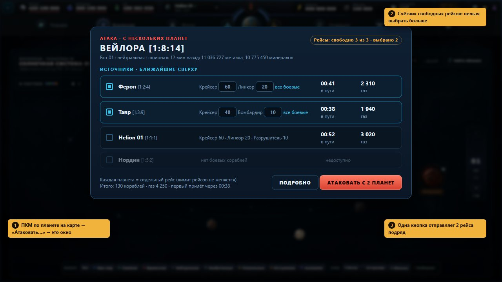
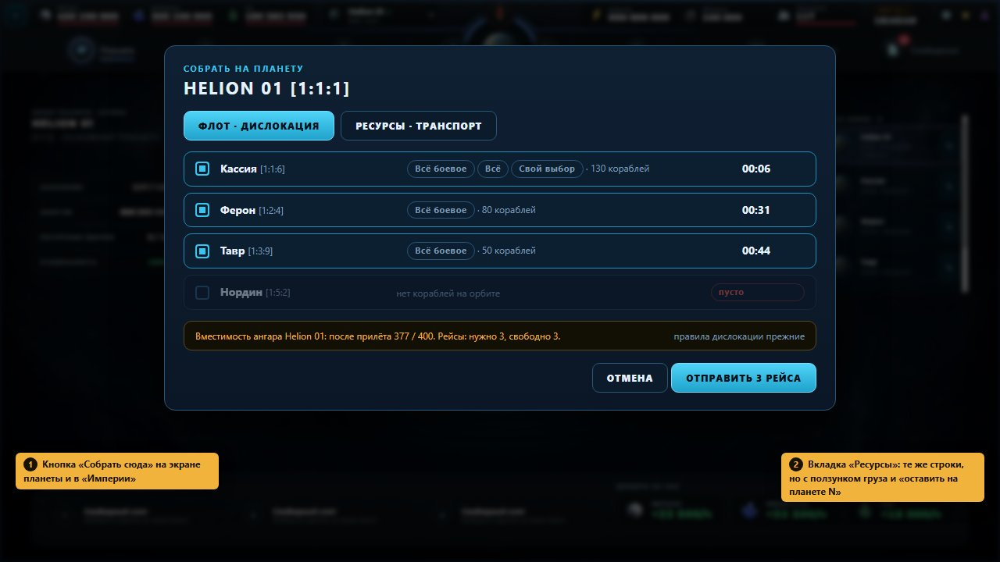
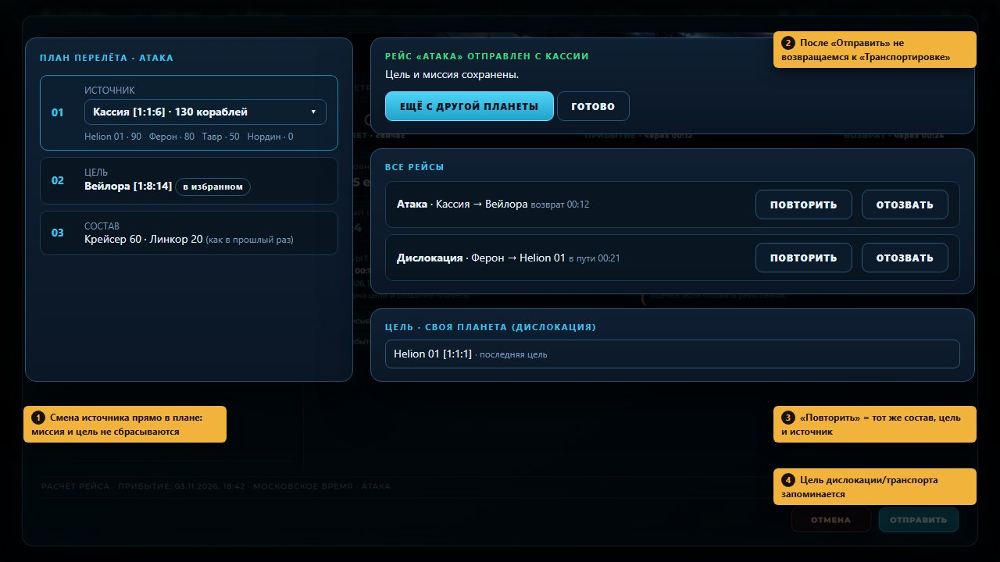
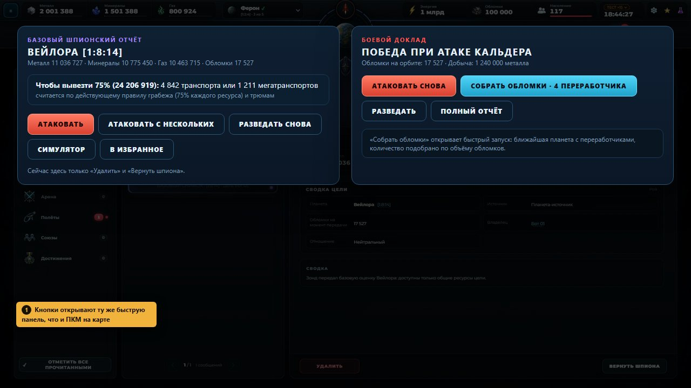
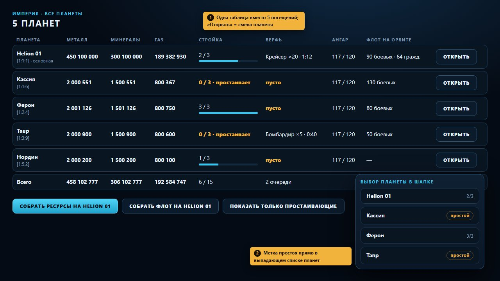

# Аудит скорости операций — 03.11.2026

**Вопрос владельца:** игра полна двойной работы. Атака с нескольких планет требует каждый раз переключать планету и заново выбирать ту же цель. Переброска флота на одну планету требует обойти все планеты. Нет окна, чтобы спланировать сразу несколько отправок. Действие с объектом на карте открывает большой диалог, а потом ещё экран флота.

**Как проверяли:** собранная игра (main `8d2a7d1`, версия 1.8.7) в тестовом режиме. Сохранение доведено до 5 планет с флотом: Helion 01 [1:1:1], Кассия [1:1:6], Ферон [1:2:4], Тавр [1:3:9], Нордин [1:5:2]. Каждый сценарий прошли руками в окне Electron и посчитали клики. Скриншоты «как сейчас» лежат в `visual-qa/ops-speed-audit/before/`, макеты «как будет» в `visual-qa/ops-speed-audit/mocks/`. Код игры в этом PR не менялся.

**Главное в трёх строках**
1. Самая дорогая операция — «одна цель, несколько планет». Атака с 4 планет занимает около **34 кликов и 4 захода на карту**, сбор флота с 4 колоний около **36 кликов**. С панелью «с нескольких планет» будет **5–6 кликов**.
2. Экран флота «забывает» всё. После «Отправить» и после смены планеты миссия сбрасывается на «Транспортировку», цель стирается. Это одна небольшая правка, и она экономит около 4 кликов на каждой следующей планете.
3. Отчёты — тупик. В шпионском и боевом отчётах нет кнопок «Атаковать», «Разведать снова», «Собрать обломки». Нет и экрана, где видно все 5 планет сразу (ресурсы, очереди, флот), поэтому простаивающую очередь приходится искать обходом всех планет.

---

## 1. Сколько кликов сейчас

Клик — это нажатие или выбор в списке. Ввод чисел считается одним действием на поле.

| # | Задача | Сейчас | Как считали | После правок | PR |
|---|---|---|---|---|---|
| 1 | Атаковать одну цель с 4 планет | **34** клика, 4 раза карта | 1-я планета: «Вселенная» → система → планета → «Начать атаку» → «МАКС.» → «Продолжить · план» → «Отправить» = 7. Каждая следующая: выбор планеты в шапке (2) + то же самое = 9 | **6** (ПКМ → «Атаковать…» → отметить ещё 3 планеты → «Атаковать с 4 планет») | 1 |
| 2 | Собрать флот с 4 колоний на Helion 01 | **36** | На каждую колонию: смена планеты (2) → «Флоты» → «Дислокация» → «МАКС.» → «Продолжить» → цель в списке (2) → «Отправить» = 9 | **3** («Собрать сюда» → проверить строки → «Отправить 4 рейса») | 2 |
| 3 | Свезти ресурсы с 4 колоний на одну планету (например, под исследование) | **≈40** | Как п. 2, плюс ввод груза на каждой планете | **3–4** | 2 |
| 4 | Повторить ту же атаку ещё раз | **7–9** | Заново карта → цель → состав | **2** («Повторить» → «Отправить») | 3 |
| 5 | Отправить вторую волну с другой планеты сразу после первой | **9** | После «Отправить» миссия = «Транспортировка», цель пустая (скрин 11, 12) | **4** («Ещё с другой планеты» → источник → «Отправить») | 3 |
| 6 | Шпионский отчёт → атаковать эту цель | **8** | В отчёте только «Удалить» и «Вернуть шпиона» (скрин 16): дальше «Вселенная» → система (список) → планета → «Начать атаку» → состав → «Продолжить» → «Отправить» | **2** («Атаковать» → «Отправить») | 4 |
| 7 | После победы собрать обломки | **6–7** | «Вселенная» → «Найти обломки» → «Отправить» → переработчиков 0, выбрать (скрин 22) → «Продолжить» → «Отправить». Поиск только вокруг текущей планеты | **2** («Собрать обломки · 4 переработчика» → «Отправить») | 4 |
| 8 | Проверить, какие из 5 планет простаивают (стройка, верфь) | **10** + чтение 5 экранов | 2 клика на смену планеты × 5 | **1** («Империя») | 5 |
| 9 | Дислокация на «свою обычную» планету | +2 каждый раз | Список «Своя планета» всегда открывается на «Выберите планету» (скрин 13) | 0 (последняя цель уже выбрана) | 3 |
| 10 | Открыть карту у планеты, на которой стоишь | +1–3 | Карта всегда открывается на домашней системе 01 (скрин 14, стоим на Ферон в системе 2) | 0 | 3 |

Что уже быстрое, трогать не нужно:
- Шпион с карты: один клик по «глазу» сразу отправляет 1 зонд с текущей планеты.
- Разведка пиратов и аномалий: тоже один клик («Разведать» в карточке объекта).
- Быстрая «+» на зданиях (PR #139): улучшение без захода в здание.

---

## 2. Все найденные места двойной работы

**Флот и цели**
- **Ф1. Нет отправки с нескольких планет.** Источник всегда «текущая планета» (`createFlightCommand` берёт `currentPlanetId`). Скрины 06, 08, 12.
- **Ф2. Смена планеты на экране флота сбрасывает миссию на «Транспортировку».** Координата цели остаётся, но атаку надо выбрать заново. Скрин 08.
- **Ф3. После «Отправить» экран обнуляется:** миссия «Транспортировка», цели нет. Вторую волну надо собирать с нуля через карту. Скрины 11, 12.
- **Ф4. Нет «Повторить рейс».** В списке «Все рейсы» можно только отозвать.
- **Ф5. Список «Своя планета» (дислокация и транспорт) не помнит прошлую цель.** Подпись при этом просит «Введите галактику, систему и позицию», хотя там список. Скрин 13.
- **Ф6. Нет избранных целей.** Слой «Метки» на карте — это номера позиций, а не закладки.
- **Ф7. Отправка всегда идёт с текущей планеты, даже если она далеко.** Это касается шпиона с карты, «Помощи союзу» (`openAidLaunch`), «Отправить флот участнику» и пиратского рейда. Ближайшую планету игра не предлагает.
- **Ф8. Лимит рейсов.** Одновременно можно держать 3 рейса + 1,5 за уровень «Компьютерных систем»; шпионаж и разведка не считаются (`src/domain/flights/limit.ts`). Отправка с нескольких планет занимает **по рейсу на каждую планету**. Панель обязана показывать «свободно N из M» и не давать выбрать больше. Это действующее правило, менять его не предлагаем.

**Карта**
- **К1. Большой диалог «Звёздный атлас».** Действия спрятаны в мелкие иконки в строке владения (скрины 03, 05). «Атака» переносит на экран флота, а это второй экран. Это уже чинит сессия `quick-actions` (ПКМ-меню).
- **К2. Карта открывается на домашней системе**, а не на системе текущей планеты (скрин 14). Лента систем показывает ±2; до системы 8 и дальше — только через список.
- **К3. «Найти обломки» ищет только вокруг текущей планеты.** «Отправить» открывает экран флота с 0 переработчиков и без подсказки, сколько их нужно (скрины 21, 22).

**Отчёты**
- **О1. В шпионском отчёте нет действий.** Есть только «Удалить» и «Вернуть шпиона» (скрин 16, `ReportsView.tsx:779-782`: в коде всего 3 вида действий — `recall_spy`, `simulate_battle`, `open_fleets`). Нет «Атаковать», «Разведать снова», «Сколько транспортов нужно».
- **О2. В боевом отчёте нет «Атаковать снова» и «Собрать обломки»** (скрин 15).
- **О3. Действие `open_fleets` открывает пустой экран флота** без цели и без миссии.

**Несколько планет**
- **П1. Нет общего обзора планет.** Ресурсы у каждой планеты свои, в шапке видны только ресурсы текущей. Очередь стройки у каждой своя: 3 слота (`state.queues[planetId]`). Верфь тоже у каждой своя. Чтобы найти простой, нужно обойти все планеты.
- **П2. Список планет в шапке и блок «Ваши миры» показывают только имя и координаты**: без простоя, без заполненности очереди (скрин 07).
- **П3. Исследование оплачивается кошельком текущей планеты** (`startScience` → `walletFor(planetId)`). Если денег на ней мало, приходится вручную везти ресурсы с каждой колонии (п. 3 таблицы).
- **П4. Торговля, производственные роботы и переработка обломков привязаны к планете**: здание внутри зоны своей планеты. Массового действия нет. Это редкие операции, отдельный PR под них не предлагаем; в «Империи» достаточно колонки со ссылкой «Открыть».

**Операции и Командование**
- **Ко1.** «Принять операцию», «Помочь союзнику», «Отправить флот участнику» ведут на экран флота текущей планеты (скрин 17). После PR 1 они должны открывать ту же быструю панель с выбором ближайшей планеты.

---

## 3. Предложения с макетами

### М1. Отправка с нескольких планет (одна цель)

ПКМ по цели → «Атаковать…» (или «Транспорт…», «Дислокация…», «Переработка…»). Открывается окно со списком своих планет, ближайшие сверху; для каждой — предложенный состав, время в пути и газ. Отмечаешь нужные и жмёшь одну кнопку: уходит по рейсу с каждой отмеченной планеты. Сверху стоит счётчик «свободно рейсов 3 из 3». Решение «можно / нельзя» по каждой строке берётся из того же `previewFlight`, что и на экране флота, поэтому новых правил нет.
**Клики:** 34 → 6. **Объём:** L (если доделывать WIP `quick-actions`: M).
**Нужно слово владельца:** «прилететь одновременно». Скорость флота сейчас выбрать нельзя (`speed.ts` без процента скорости), а выравнивание прилёта — это новая механика. В макете её нет. Совместный бой нескольких флотов в одной битве — тоже новое правило, не предлагаем.

### М2. «Собрать на планету» (флот или ресурсы)

Кнопка «Собрать сюда» на экране планеты и в «Империи». Вкладка «Флот» отправляет дислокацию со всех отмеченных планет («всё боевое / всё / свой выбор»). Вкладка «Ресурсы» отправляет транспорт с грузом и полем «оставить на планете N». Действующие правила (блокировка дислокации по населению цели, лимит рейсов) показываются в строке, а не после ошибки.
**Клики:** 36 → 3. **Объём:** M (на базе панели М1).

### М3. Экран флота не забывает цель

- Источник можно сменить прямо в шаге «01 ИСТОЧНИК» плана перелёта. Миссия, цель и состав не сбрасываются.
- После «Отправить» появляется плашка «Ещё с другой планеты» вместо сброса на «Транспортировку».
- «Повторить» в списке «Все рейсы»: тот же источник, цель и состав.
- Список «Своя планета» открывается на последней цели. Подпись исправлена.
- Карта открывается на системе текущей планеты.
- «Избранное» (звезда у цели) — локальная закладка, без игровых последствий.

**Клики:** −4…−7 на каждую повторную отправку. **Объём:** S–M.

### М4. Кнопки действий в отчётах

- **Шпионский отчёт:** «Атаковать», «Атаковать с нескольких», «Разведать снова», «Симулятор», «В избранное». Плюс строка «сколько транспортов нужно, чтобы вывезти добычу». Считается по действующему правилу грабежа (75% каждого ресурса, `calculateAttackLoot`) и трюмам: транспорт 5 000, мегатранспорт 20 000. Для Вейлоры из скрина 16 это 4 842 транспорта или 1 211 мегатранспортов.
- **Боевой отчёт:** «Атаковать снова», «Собрать обломки · N переработчиков» (N по объёму обломков и трюму переработчика), «Разведать».
- **«Найти обломки» на карте:** «Отправить» сразу предлагает число переработчиков и ближайшую планету, где они есть.

Все кнопки открывают ту же быструю панель М1, отдельного экрана нет.
**Клики:** 8 → 2 (атака из отчёта), 6–7 → 2 (обломки). **Объём:** M.

### М5. «Империя» — все планеты на одном экране

Таблица: планета, металл, минералы, газ, стройка (n/3), верфь, ангар (население / вместимость), флот на орбите, рейсы; внизу строка «Всего». Простой подсвечен. «Открыть» переключает планету. Кнопки «Собрать ресурсы / флот на …» открывают М2. В выпадающем списке планет в шапке появляются метки «простой» и заполненность очереди.
**Клики:** 10+ → 1. **Объём:** M–L (только чтение уже имеющихся данных).

**Не предлагаем без слова владельца:**
- общий кошелёк планет (оплата исследования с любой планеты);
- одна общая очередь стройки на все планеты;
- массовая постройка «одно здание на всех планетах сразу»;
- изменение лимита рейсов;
- выбор скорости флота.

Всё это меняет правила, а не интерфейс.

---

## 4. План PR по порядку (больше всего сэкономленного времени — первым)

Состояние на сейчас: сессия `quick-actions` остановилась с локальным коммитом `8a3fee5` в ветке `claude/quick-actions`: «WIP: quick actions model, tests and menu component (not wired yet)». В origin он не отправлен. В коммите `src/application/quick-actions.ts` (список действий по объекту, `planQuickSend` — план с одной, ближайшей планеты), `src/ui/universe/QuickActions.tsx`, `quick-actions.css` и тесты. В игру это пока не подключено, отправки с нескольких планет нет.

### PR 1 — Быстрые действия на карте + отправка с нескольких планет (М1)
- **Что:** доделать WIP `quick-actions`: ПКМ-меню на объекте карты, подключённое в `UniverseView.tsx` и `App.tsx`. Расширить панель до нескольких источников: `planQuickSend` → список планов по всем своим планетам, сортировка по времени в пути, флажки, одна кнопка. Отправка — последовательные `dispatchFlight` с проверкой результата каждого; при ошибке остальные не отправляются, игрок видит понятное сообщение.
- **Файлы:** `src/application/quick-actions.ts` (+ тесты), `src/ui/universe/QuickActions.tsx`, `src/ui/universe/quick-actions.css`, `src/UniverseView.tsx`, `src/App.tsx` (обработчик отправки рядом с `onDispatchRequest`).
- **Правила:** только через `previewFlight` и `dispatchFlight`. Лимит рейсов: счётчик `getPlayerFlightSlotUsage`, флажков не больше, чем свободных рейсов. Блокировка во время догонки NPC (`rejectNpcCatchupCommand`) работает.
- **Готово, когда:** на сейве с 4+ планетами ПКМ по чужой планете → «Атаковать…» → отмечены 3 планеты → одна кнопка → 3 рейса в «Все рейсы», лимит учтён; при 2 свободных рейсах третий флажок недоступен. Тесты модели (`node --test`), Electron-скрины 1920×1080 и 1280×720, худший случай: 7 планет, длинные имена, 0 кораблей.
- **Объём:** L. **Экономия:** ~28 кликов на каждую атаку с 4 планет.

### PR 2 — «Собрать на планету»: флот и ресурсы (М2)
- **Зависит от:** PR 1 (панель и многорейсовая отправка).
- **Что:** кнопка «Собрать сюда» на экране планеты (`src/ui/planet/PlanetOrbitView.tsx`) и в «Империи» (PR 5). Окно с двумя вкладками: «Флот» (миссия `deployment`) и «Ресурсы» (миссия `transport`, груз по `transportSummary` и поле «оставить N»). Источники — все свои планеты, кроме цели.
- **Готово, когда:** с 4 колоний флот одной кнопкой уходит на Helion 01. Строки с заблокированной дислокацией (население цели, `target.blocked`) показаны красным с причиной. Ресурсы свозятся с подбором транспортов по грузу. Скрины + тесты расчёта груза.
- **Объём:** M. **Экономия:** ~33 клика на каждый сбор.

### PR 3 — Экран флота не теряет цель (М3)
- **Независим от PR 1–2** (другие файлы), можно делать параллельно.
- **Что:**
  1. Смена источника внутри плана перелёта (шаг 01) без смены текущей планеты: `previewOriginPlanetId` уже есть в `FleetWorkspacePortal.tsx`.
  2. Не сбрасывать миссию и цель при смене планеты в шапке и после «Отправить»; плашка «Ещё с другой планеты».
  3. «Повторить» в «Все рейсы»: команда из `FlightRecord` — источник, цель, состав.
  4. Последняя цель «Своя планета» для дислокации и транспорта; поправить подпись «Введите галактику…».
  5. Карта открывается на системе текущей планеты (`UniverseView.tsx`, начальная система).
  6. Избранные цели: звезда в плане и список в шаге 02. Хранятся в сохранении как UI-данные, без влияния на игру.
- **Файлы:** `src/FleetWorkspacePortal.tsx`, `src/UniverseView.tsx`, при необходимости `src/application/contracts.ts` (поле избранного, миграция сохранения).
- **Готово, когда:** сценарии из таблицы п. 4, 5, 9, 10 проходят за указанные клики. Electron-тест: атака → «Отправить» → «Ещё с другой планеты» → смена источника → «Отправить» без захода на карту.
- **Объём:** S–M. **Экономия:** 4–7 кликов на каждую повторную отправку.

### PR 4 — Кнопки в отчётах и обломки (М4)
- **Зависит от:** PR 1 (кнопки открывают панель).
- **Что:** новые виды действий в `buildReportsFeed` / `ReportsView.tsx`: `attack`, `attack-multi`, `spy-again`, `recycle-debris`. Строка «нужно N транспортов» по `calculateAttackLoot` (75%) и трюмам каталога. «Найти обломки» и «Собрать обломки» предлагают число переработчиков и ближайшую планету с ними.
- **Файлы:** `src/ReportsView.tsx`, `src/domain/reports/*`, `src/BattleReportsView.tsx` (кнопка в полном отчёте), `src/UniverseView.tsx` (поиск обломков), `src/App.tsx`.
- **Готово, когда:** из шпионского отчёта атака отправляется за 2 клика, из боевого обломки собираются за 2 клика. Для отчёта о цели, которая исчезла или стала союзником, кнопки скрыты с подсказкой. Тесты фида и скрины.
- **Объём:** M. **Экономия:** 6 кликов на атаку из отчёта, 5 на обломки.

### PR 5 — «Империя»: обзор всех планет (М5)
- **Независим**, можно делать параллельно с PR 3.
- **Что:** новый экран (пункт в навигации или кнопка у выбора планеты). Таблица по всем планетам: ресурсы (кошелёк планеты), очередь стройки n/3, верфь, ангар, флот на орбите, рейсы с этой планеты; итоговая строка. Метки простоя в выпадающем списке планет в шапке (`src/ui/header/AsterionHeader.tsx`). Кнопки «Собрать сюда» подключаются после PR 2.
- **Файлы:** новый `src/EmpireView.tsx` + css, `src/App.tsx` (маршрут), `src/ui/header/AsterionHeader.tsx`.
- **Готово, когда:** на 7 планетах таблица помещается в 1280×720 без горизонтальной прокрутки; простой подсвечен; «Открыть» переключает планету. Худший случай: длинные имена, 0 ресурсов, все очереди пустые.
- **Объём:** M–L. **Экономия:** около 10 кликов и 5 экранов на каждую проверку планет.

**Порядок:**
- PR 1 → PR 2 → PR 4 идут друг за другом: у них общая панель.
- PR 3 и PR 5 можно запускать параллельно с PR 1: файлы не пересекаются. Исключение — `App.tsx`; там правки небольшие, конфликты простые.
- Версия у всех PR: только PATCH.

---

## 5. Нужно слово владельца
1. **Прилёт нескольких флотов одновременно** (выбор скорости или задержка вылета) — новая механика.
2. **Совместный бой** нескольких флотов в одной битве — новое правило боя.
3. **Общий кошелёк** (оплата исследования или стройки с любой планеты) — меняет экономику.
4. **Массовая постройка** «одно здание на всех планетах сразу» — правило очереди.
5. **Лимит рейсов** — сейчас 3 + 1,5 за уровень; панель его соблюдает, менять не предлагаем.

## Приложение: скриншоты «как сейчас»
`visual-qa/ops-speed-audit/before/`:
- 01 — пять планет;
- 02–05 — карта и диалоги «Звёздного атласа»;
- 06 — атака с карты → экран флота;
- 07 — список планет в шапке;
- 08 — после смены планеты миссия = «Транспортировка»;
- 10 — план перелёта;
- 11–12 — после «Отправить» всё сброшено;
- 13 — дислокация без запомненной цели;
- 14 — карта открылась на системе 01, хотя стоим на Ферон;
- 15 — боевой отчёт;
- 16 — шпионский отчёт;
- 17 — операции;
- 21–22 — «Найти обломки» → 0 переработчиков.

Макеты пересобираются командой `npx electron visual-qa/ops-speed-audit/mocks/render-mocks.cjs`.
