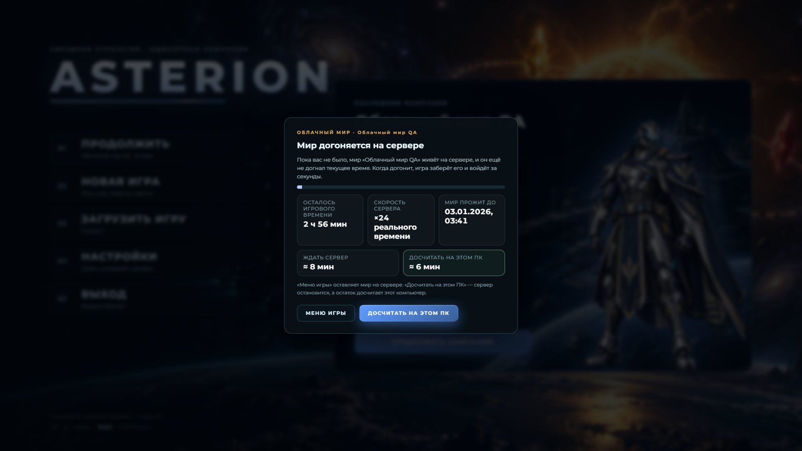
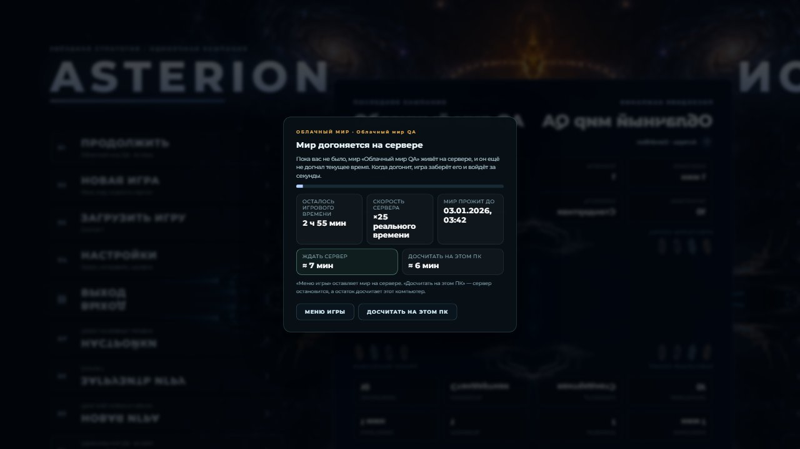
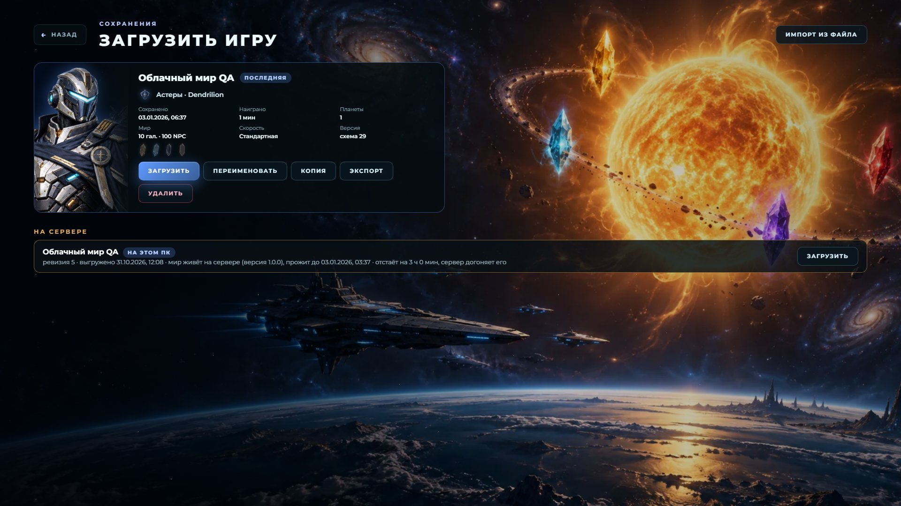
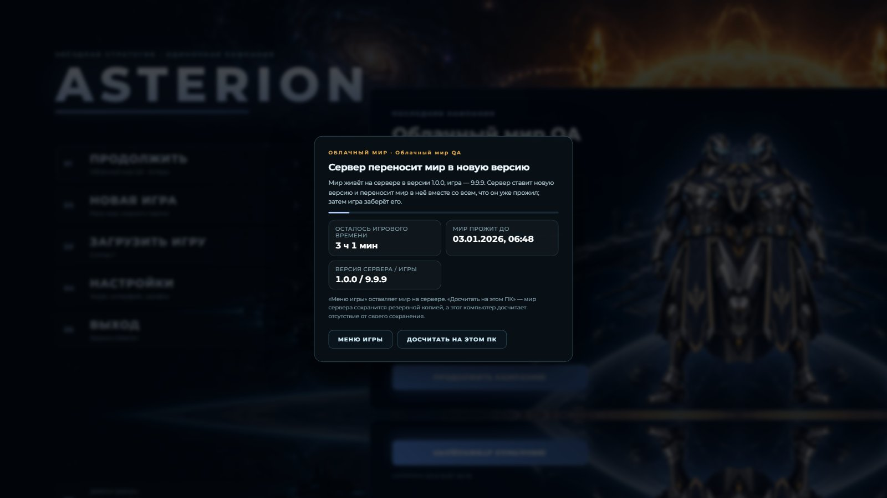
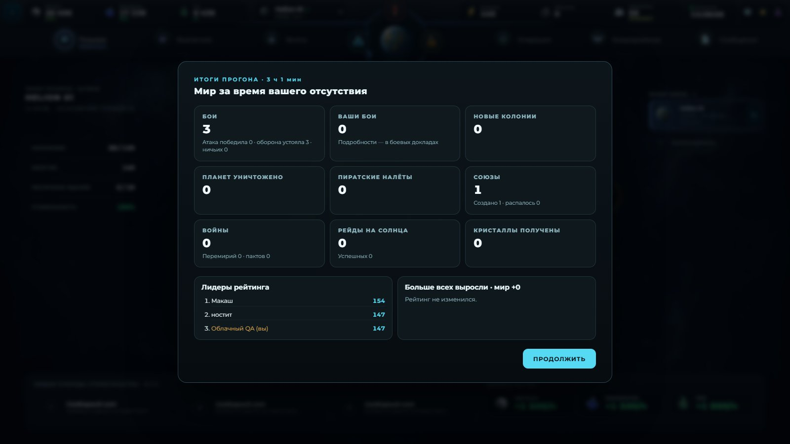

# Прогон на сервере; обновления его не сбрасывают — 31.10.2026

PR 9, ветка `claude/server-catchup` (от main 1.1.0). Метка `release:minor`: меняется протокол клиент–сервер
(новое решение входа «ждать», `POST /v1/update-request`, скорость догонки в ответах сервера).
Боевой сервер `asterion-vps` не трогался: всё проверено на локальном сервере и на настоящих
опубликованных бандлах 1.0.2/1.1.0, запущенных на этом ПК.

## Коротко

- **Обновление не сбрасывает работу сервера.** Сервер новой версии при запуске сам переносит живой мир
  в свой релиз: старый сервер пишет контрольную точку раннером старой версии, новый раннер читает её
  загрузчиком новой версии (миграция только вперёд) и живёт дальше. Игра новой версии забирает мир без
  «другой версии». Проверено на **настоящих релизах**: сервер 1.1.0 с миром в раннере 1.0.2 (как сейчас у
  владельца) → самообновление на сборку этой ветки → мир переехал, ничего не потеряно, забранный мир
  **равен** продолжению контрольной точки 1.0.2 кодом этой ветки.
- **Мир, который ещё догоняется на сервере, игра не забирает.** Если мир на сервере отстаёт больше чем на
  2 игровые минуты, вместо локального прогона открывается окно **«Мир догоняется на сервере»**: сколько
  осталось, скорость сервера, сколько ждать сервер и сколько считал бы этот ПК. Сервер догнал — игра
  забирает мир и входит за секунды. «Меню игры» оставляет мир на сервере, «Досчитать на этом ПК» —
  явный выбор прежнего пути.
- **Игра новее сервера** не досчитывает свою старую копию: просит сервер обновиться и ждёт, пока он
  перенесёт мир. **Игра старее мира** говорит обновиться; досчитать локально можно только явной кнопкой.
- **«Загрузить игру → На сервере»** больше не пустой: там все кампании сервера, включая кампании этого ПК,
  с тем, что сервер делает с миром (живёт, насколько отстаёт, скорость, когда догонит).
- **Карточка сохранения:** «561 NPC» → число NPC-владельцев (считались их планеты).
- **«Итоги прогона» — только после отсутствия дольше 3 игровых часов** (одна константа); короче — мир
  догоняется тихо. Свёрнутая игра больше не останавливает часы (нет «прогона» после переключения окон).
- **Нестабильные проверки:** обе — не от живого воркера #119 (тестовый режим работает без воркера; те же
  падения были 25–26.10 до #119, в том числе на main). Найдена и закрыта соседняя гонка того же класса в
  `test:spaceport-ui` (часть `qa:visual`); в `test:fleet-ui` добавлена диагностика. Подробности ниже.

## Что случилось у владельца (30–31.10)

Мир «Кампания Роя» был выгружен, когда его время уже отставало на ~26 ч (локальный прогон не
досчитан). Сервер (одно ядро, nice 10) за 2 ч продвинул мир на 8,9 игровых ч (≈4,4×). В 00:01 игра забрала
мир (claim) с 19 ч 10 мин отставания и запустила локальный прогон на ~1 ч 30 мин. Теперь в этой ситуации
игра покажет окно ожидания с обоими временами — «ждать сервер ≈ 5 ч 40 мин» (19 ч 10 мин при ×4,4; часы
идут дальше) против «досчитать на этом ПК ≈ 1 ч 40 мин» (по измеренной скорости этого ПК) — и подсветит быстрый вариант. Решает игрок.

## 1. Переход версии на сервере

Как это происходит на VPS:

1. `asterion-update.timer` (раз в 30 мин) или `asterion-update.path` (по запросу игры) ставит
   `/opt/asterion/releases/X.Y.Z` и делает `systemctl restart asterion`.
2. Старый сервер получает SIGTERM: раннер старой версии пишет контрольную точку (схема старой версии), сервер
   записывает её в `campaign.json` и выходит. Этот код уже есть в 1.1.0 — ничего не нужно менять на боевом.
3. Новый сервер при запуске (`migrateLive` в `server/src/server.ts`): у каждой кампании, чей живой мир
   принадлежит **более старой** версии, а для своей версии раннер есть, — `live.gameVersion` := своя версия,
   в `live.migrations` пишется `{ from, to, at, worldAt }`, в журнал — `live <slot>: moved from game X to Y`.
   Затем мир поднимается раннером новой версии **с контрольной точки** (`resume`), догоняет простой и
   живёт дальше. Время мира не откатывается.
4. Если раннер новой версии не смог загрузить мир (вышел до `ready`), мир возвращается в раннер старой
   версии (`back to X`, `live.migrationError`) — его релиз ещё установлен.
5. Старые релизы удаляет `update.sh` по-прежнему: хранятся 3 последних, текущий и все, в которых живёт мир.
   После переноса старый релиз больше никому не нужен и уходит по правилу «3 последних».

Ещё: раннер пишет контрольную точку и тогда, когда его сервер умер (падение, OOM), но сервер не успел её
записать в `campaign.json`. Теперь следующий запуск продолжает с этого файла, а не с базовой ревизии.

**Игра новее сервера** (релиз уже у игрока, сервер ещё не скачал): мир живёт в старой версии →
решение «ждать» (`server-updating`), игра шлёт `POST /v1/update-request` (сервер кладёт файл
`update-request`, `asterion-update.path` сразу запускает обновление; повтор раз в 2 мин, пока окно
открыто) и ждёт, пока новый сервер перенесёт мир, — затем забирает его как обычно. То же делает и claim
с версией новее сервера. **Игра старее мира** (`game-older`): окно «Мир на сервере живёт в более новой
версии · обновите игру»; ничего не портится. Игры 1.1.0 и старше этого не знают: у них, как раньше,
«другая версия» → локально, мир сервера — в резервную копию.

### Проверка на настоящих релизах (`npm run cloud:version-move`)

Бандлы `asterion-server-1.0.2.tgz` и `asterion-server-1.1.0.tgz` скачаны из GitHub Releases, сборка этой
ветки — как релиз 1.2.0, раскладка как у `update.sh`. Мир — `late-game-day-1.json` (схема 28, 19 млн
символов), оставлен игрой 1.0.2 на 3 ч позади часов (как у владельца — мир выгружен с отставанием).

| Шаг | Результат |
|---|---|
| сервер 1.1.0, мир в раннере 1.0.2 | за 90 с прожито 54,1 игровых мин, отставание 127 мин |
| остановка 1.1.0 как systemd (SIGTERM) | 1,6 с; контрольная точка раннера 1.0.2: схема 28, 56,7 мин — записана в `campaign.json` |
| запуск сервера 1.2.0 | `moved from game 1.0.2 to 1.2.0`, `started (game 1.2.0, from checkpoint)`; мир на 58,5 мин — **не откатился** |
| 60 с жизни в 1.2.0 | 87,3 мин, скорость ×28,8 |
| claim игрой 1.0.2 / 1.2.0 | 409 / 200; мир схемы 29, 89,6 мин; сводка отсутствия — от момента ухода игрока |
| равенство | забранный мир **равен** продолжению контрольной точки 1.0.2 кодом этой ветки до того же курсора (после загрузки, как игра читает сохранение) |

Сравнение «с полным локальным прогоном от сохранения ухода» для перехода версий не имеет смысла: первую
часть отсутствия считал код 1.0.2 (другие правила). Внутри одной версии сервер = локальный прогон
(`server.test.ts`, тест переноса — побайтно после загрузки).

На Windows процесс не может получить SIGTERM, поэтому инструмент запускает бандлы через обёртку, которая по
`stop` в stdin вызывает тот же обработчик SIGTERM, — путь тот же, что у systemd.

## 2. Мир догоняется на сервере — игра его не забирает

**Порог — 2 игровые минуты** (`SERVER_CATCHUP_WAIT_LAG_MS`, `cloud-sync.ts`). Почему так: в обычной
эстафете отставание живого мира 0–10 с (шаг раз в 10 с), а сразу после выгрузки сервер догоняет за
секунды-минуту, поэтому обычный вход окна не увидит. А то, что остаётся после claim (≤ 2 мин игры плюс
передача), игра досчитывает за секунды даже на позднем мире (день 3 — ~4 с на игровую минуту). Ждать
меньшего отставания бессмысленно: последние 2 минуты сервер одним ядром считает дольше, чем ПК.

Правила входа (`decideCloudEntry` → `claimOrLocal`):

| Живой мир на сервере | Решение |
|---|---|
| та же версия, отставание ≤ 2 мин (или мир не идёт: пауза/сбой) | claim, как раньше |
| та же версия, отставание > 2 мин, мир идёт | **ждать** (`catching-up`) — без claim, без `endLive`, без локального прогона |
| версия мира старше игры, или сервер ждёт релиз | **ждать** (`server-updating`) + запрос обновления |
| версия мира новее игры | **ждать** (`game-older`) — «обновите игру» |
| «Досчитать на этом ПК» (`takeNow`) | `catching-up` → claim сейчас; другая версия → прежний путь: локально, мир сервера — резервная копия |

Окно (`ServerWaitWindow`, `CloudMenu.tsx`) опрашивает сервер раз в 3 с. Сервер теперь отдаёт у живого
мира `rate` (игровых мс за мс, по истории статусов раннера за 2 мин) и `etaMs = lag / (rate − 1)`; если
сервер старый и скорости не даёт, окно считает её само по опросам. «Досчитать на этом ПК» — по скорости
прогона **этого ПК для этой кампании**: окно прогона (`NpcCatchupBanner`) запоминает её после каждого
прогона дольше 10 с (`asterion.cloud.local-catchup-rate.v1`); для кампании, которую этот ПК ещё не
досчитывал, берётся последняя измеренная скорость другой кампании с поправкой на размер сохранения, а без
измерений — скорость сервера × 1,7 (EPYC VPS против настольного ЦП, из отчёта облака); тогда рядом
«(оценка)». Быстрый вариант подсвечен; если ПК заметно быстрее, кнопка «Досчитать на этом ПК» — основная.

Без сети / сервер недоступен — как раньше: локально, с причиной («Нет связи с сервером…»). Если связь
пропала, пока открыто окно, — строка «Нет связи с сервером. Мир остаётся на сервере; пробуем снова…».

### Почему блок «На сервере» был пустым

Это был дефект замысла: блок показывал только кампании, которых **нет** на этом ПК (второй компьютер), а у
владельца одна кампания, и она есть на ПК, — оставалась строка «Все кампании сервера уже есть на этом
компьютере». Теперь там все кампании сервера: свои — с меткой «НА ЭТОМ ПК», строкой о мире (живёт / в ногу
со временем / отстаёт на X, скорость, когда догонит) и кнопкой «ЗАГРУЗИТЬ» (тот же вход с ожиданием);
чужие — «ЗАГРУЗИТЬ С СЕРВЕРА». Список обновляется раз в 10 с.

### Цифры на позднем мире (локальный сервер, этот ПК)

Мир дня 2 (`late-game-day-2.json`, 100 NPC, 10 галактик), локальный сервер на этом ПК (Ryzen 5 5600,
раннер одним ядром, как на VPS), `npm run test:cloud-world-ui -- --fixture=… --only-catchup`.
Сценарий владельца: игрок вернулся через 3 ч (6 ч во втором прогоне), игра забрала мир и начала
локальный прогон, игрок вышел посреди него — сервер получил мир, отстающий на эти часы.

| | 3 ч позади | 6 ч позади |
|---|---|---|
| «На сервере» в «Загрузить игру» | «отстаёт на 3 ч 0 мин, сервер догоняет его» | «отстаёт на 6 ч 0 мин…» |
| окно при «Продолжить» | «Мир догоняется на сервере», 0,45 с от клика | то же, 0,4 с |
| в окне: осталось / скорость | 2 ч 56 мин / ×24 | 5 ч 57 мин / ×23 |
| в окне: ждать сервер / этот ПК | ≈ 8 мин / ≈ 6 мин | ≈ 17 мин / ≈ 19 мин |
| фактически сервер догонял | 10,5 мин | 25 мин |
| claim, пока окно открыто | ни одного (мир на сервере всё время `running`) | ни одного |
| после claim мир отставал на | 37 с, остаток локально 3,6 с | 35 с, остаток 4,1 с |
| «Досчитать на этом ПК» | claim за 4,9 с, локальный прогон 3 ч пошёл | — |
| игра новее сервера (9.9.9) | ждала 8,4 мин: обновление сервера, перенос мира, его догонка 3 ч; затем вход | — |

Оценка «ждать сервер» оказалась меньше факта (8 → 10,5 и 17 → 25 мин): в обоих прогонах на том же ПК
параллельно шли мои наборы тестов, и скорость сервера проседала с ×24 до ×9–15 (видно по замерам окна
раз в минуту). Окно пересчитывает оценку на каждом опросе, так что она поправляется по ходу. На VPS
скорость сервера для мира такого размера ниже (EPYC ~1,7× медленнее) — у владельца было ×4,4 на мире
дня ~6 (75 МБ).

## 3. Карточка сохранения: NPC

`describeSave` считал NPC-планеты (`espionage.targets` с владельцем-NPC), а не владельцев: мир на 100
NPC с выросшими империями показывал «561 NPC». Теперь — число разных `ownerId` с `isGeneratedNpcOwnerId`
(тест `save-safety.test.ts`: у каждого NPC ещё две колонии → число = владельцы). Других мест, где сводка
строится, нет (`refreshSlotMeta`, импорт и создание слота идут через `describeSave`); облачный список
NPC не показывает; число в `cloud-world-qa.cjs` — затравка индекса, её исправляет тот же механизм.

Старые слоты: экран «Загрузить игру» и так читает каждое сохранение для проверки здоровья
(`inspectSlot`); теперь проверка возвращает свежую сводку, и если она отличается от сохранённой в индексе,
индекс обновляется (`updateSlotSummary`, даты слота не трогаются). То есть у владельца число исправится при
первом открытии «Загрузить игру», без лишнего чтения 75 МБ. На скриншоте ниже — «100 NPC» у мира дня 2,
для которого индекс QA был засеян значением 6.

## 4. «Итоги прогона» — только после отсутствия дольше 3 часов

Решение владельца 31.10: окно «Мир за время вашего отсутствия» — только если игрок отсутствовал (по
игровому времени, длина догнанного отрезка) **больше 3 часов**; короче — мир догоняется тихо.

- Порог — одна константа `WORLD_SUMMARY_MIN_ABSENCE_MS` (`src/application/world-catchup-summary.ts`),
  правило — `isWorldSummaryWorthShowing`: `finishedAt − fromAt > 3 ч`.
- `NpcCatchupBanner`: итоги отсутствия ≤ 3 ч сразу убираются из сохранения, окна нет. Итоги отсутствия
  > 3 ч показываются, как бы оно ни было догнано: здесь, в сохранении, на котором игра закрылась, или
  **на облачном сервере** (мир, забранный из окна «Мир догоняется на сервере», несёт закрытую сводку
  сервера — она показывается). Прежнее правило «окно итогов только если окно прогона успело показаться»
  убрано: долгое отсутствие на маленьком мире могло догнаться быстрее 0,5 с и остаться без итогов.
- Окно прогона: при отсутствии > 3 ч — как раньше, через 0,5 с; при коротком — только если прогон идёт
  дольше 4 с (поздний мир), чтобы было видно, почему ждут приказы. Короткий прогон без окна.
- Если сервер прожил первую часть отсутствия, а остаток игрок досчитал на ПК («Досчитать на этом ПК»),
  итоги — одни на всё отсутствие: сводка, закрытая ровно на курсоре прогона, продолжается
  (`catchupSummaryFor` в `reconcile.ts`, `freezeNpcCatchupTarget`), а не начинается заново.

**Почему прогон запускался после «нескольких секунд».** Прогон (с блокировкой приказов и новой сводкой)
начинается, когда курсор мира отстаёт от часов больше чем на 2 минуты (`NPC_CATCHUP_COMMAND_GRACE_MS`,
`needsNpcCatchupBefore`/`catchupSummaryFor`). Мир двигается тиком страницы раз в секунду (с #119 тик
считает воркер, но запускает его страница). Когда окно игры свёрнуто или закрыто другим окном, Chromium
троттлит таймеры фоновой страницы (до раза в минуту, а при блокировке экрана/сне — вовсе), и после
возвращения курсор отстаёт на минуты → «прогон» и окно итогов на «0–3 мин». Теперь в главном окне
Electron `backgroundThrottling: false`: свёрнутая игра продолжает тикать раз в секунду, и после
переключения окон прогона нет вовсе — обычный тик без блокировки приказов. Сам порог 2 мин не трогал:
приказ, применённый к миру, где NPC отстают больше чем на 2 мин, менял бы исход прогона (детерминизм).
После сна компьютера прогон будет, но при отсутствии ≤ 3 ч — тихий.

Проверки: `npc-catchup-summary-window.test.ts` (в `test:npc`): 2 ч 59 мин — нет окна, ровно 3 ч — нет,
3 ч 01 мин — есть, «секунды» — нет; продолжение сводки сервера локальным остатком. Electron:
`test:catchup-summary-ui` (новый, в CI, шард campaign-command) — встроенная игра открывает кампанию,
оставленную 2 ч 59 мин назад (итогов нет ни на экране, ни в сохранении) и 3 ч 01 мин назад (окно итогов).

## 5. Нестабильные проверки после мержа #119 (run 41127515696)

**`qa:visual` — «Build queue did not persist after gas-production-1».** С живым воркером не связано:
`visual-capture.cjs` работает в тестовом режиме (`?mode=test`), а там воркера нет
(`liveWorldUnavailable = RUNTIME_MODE !== 'production'`), запись идёт как до #119. То же падение (то же
состояние: очередь и кошелёк ровно после предыдущей команды, уведомление «добавлено») есть в логах 26.10 —
до #119, включая прогон на main. Найти, что откатывает состояние, не удалось (разобраны пути
`flushSync`/очереди React, тик, `storage`-события, отложенные и порционные записи; ни один не даёт
отката к состоянию предыдущей команды). Локально 3 прогона подряд — эта проверка прошла все три.

Зато в тех же прогонах нашлась **соседняя гонка того же класса** в `test:spaceport-ui` (запускается
внутри `qa:visual`): «offline completion mismatch» — фикстура записывается, `location.reload()`
асинхронен, и сохранение работающей игры (тик или запись при уходе со страницы) ложится поверх фикстуры
до выгрузки страницы. В `visual-capture.cjs` от этого уже стоит защита, в
`integration-spaceport-upgrades.cjs` её не было. Теперь ключ сохранения до ухода документа принимает
только запись (или удаление) самой фикстуры. Это правильная причина, а не таймаут.

**`test:fleet-ui` — «recycle validation attempt 1/2 lost the typed coordinate».** Тоже не от #119:
тестовый режим, и то же падение есть в логах 25–26.10 (в том числе локальный прогон main). Состояние при
падении: миссия — переработка, корабли выбраны, превью открыто, статус «Цель подтверждена» вместо
«нет обломков»; значит, проверялась не введённая координата, а цель запуска, и повторный ввод не помогает.
Причину по коду установить не удалось; в дамп падения добавлены введённые поля, текст шага цели, миссия и
координаты обломков — следующее падение покажет, потерялся ввод или на альтернативной координате
оказались обломки.

Прогоны на этой ветке (Windows, этот ПК): `qa:visual` — 3 из 3 после исправления (до него: 1 из 3,
два падения «offline completion mismatch», оба — при параллельной нагрузке на ЦП, т. е. именно эта гонка;
build queue — 6 из 6 прошли); `test:fleet-ui` — 3 из 3, ни одного повтора ввода координаты.

## Проверки

| Проверка | Результат |
|---|---|
| `npm run build` (tsc + vite), `build:server` | проходят |
| `test:inventory` | 157 файлов, 0 пропущено, 0 вне CI |
| `test:cloud` (сервер: перенос живого мира при обновлении с паритетом, откат при сбое нового раннера, скорость догонки, запрос обновления от игры новее; правила входа: ожидание, порог, «досчитать на ПК», клиент новее/старее) | 19/19 |
| логические наборы CI (application, buildings, flights, attack, pirate-operations, espionage, combat, pirates, repair, operations, command, reports, settings, rating, release, runtime, resources, energy, fleet, science, universe, exploration, sun-raid, new-game) | все зелёные |
| `test:npc` (с новым `npc-catchup-summary-window.test.ts`) | 181/181, 2 пропуска (30-дневные горизонты, как на main) |
| `cloud:version-move` — настоящие релизы 1.0.2/1.1.0 → эта ветка | мир перенесён, прогресс сохранён, мир = продолжение контрольной точки 1.0.2 |
| `test:cloud-world-ui` (маленький мир, как в CI) | проходит (3 полных прогона на финальной сборке и до неё) |
| `test:cloud-world-ui --fixture=late-game-day-2 --only-catchup` | проходит (3 ч и 6 ч позади; второй прогон упал на моём же таймауте 15 мин у «игры новее» — окно правильно ждало догонку, лимит поднят до 75 мин) |
| `test:catchup-summary-ui` (новый, в CI) | проходит: 2 ч 59 мин — тихо, 3 ч 01 мин — итоги |
| `test:save-safety-ui`, `test:late-save-ui` (дни 2–3), `test:npc-replay-ui-6h` | проходят |
| `test:fleet-ui` | 3/3 |
| `qa:visual` | 3/3 (после исправления гонки фикстуры спейспорта) |

Известно и не трогалось: `test:science-ui` и `test:production-test-isolation-ui` локально падают и на main.

## Скриншоты (с реального состояния: локальный сервер, живой мир)

Окно «Мир догоняется на сервере» (мир дня 2, 3 ч позади; 1920×1080 и 1280×720):

«Загрузить игру → На сервере» — кампания этого ПК живёт на сервере и отстаёт (и «100 NPC» в карточке):

Игра новее сервера (сервер обновляется и переносит мир) и игра старее мира (маленький мир CI):

Итоги после 3 ч 01 мин отсутствия (`test:catchup-summary-ui`):

Правки сохранения для скриншотов: часы страниц и сервера сдвинуты на время мира (как во всём облачном QA);
в индекс слотов QA засевает карточку (её «6 NPC» экран исправил на настоящие 100). Сам мир не правился.

## Что не сделано и ограничения

- **Первый переход у владельца.** Пока на боевом сервер 1.1.0, он не знает `update-request`: игра 1.2.0
  (эта версия) при мире в 1.0.2 покажет «Сервер переносит мир в новую версию» и будет ждать, пока таймер
  `asterion-update` (раз в 30 мин) поставит 1.2.0 — тогда мир переедет и игра его заберёт. Можно не ждать:
  «Досчитать на этом ПК» (прежний путь). Дальше сервер обновляется по запросу игры за минуты.
- **Игры 1.1.0 и старше** при мире в новой версии ведут себя по-старому: локально, мир сервера — в
  резервную копию. Ничего не портится, но работа сервера для такого входа не используется.
- **Скорость сервера на догонке не изменилась** (одно ядро, nice 10) — параллельный расчёт NPC на двух
  ядрах — отдельный PR 10.
- Оценка «досчитать на этом ПК» для кампании, которую ПК ещё не досчитывал, приблизительная (по размеру
  сохранения или ×1,7 от сервера) и помечена «(оценка)».
- Причины двух старых нестабильностей (`qa:visual` build queue, `test:fleet-ui` recycle) не найдены — см.
  раздел 5; обе существовали до #119, у второй теперь подробный дамп.
- Прогон после сна компьютера остаётся (курсор отстаёт больше 2 мин); при отсутствии ≤ 3 ч он тихий.
