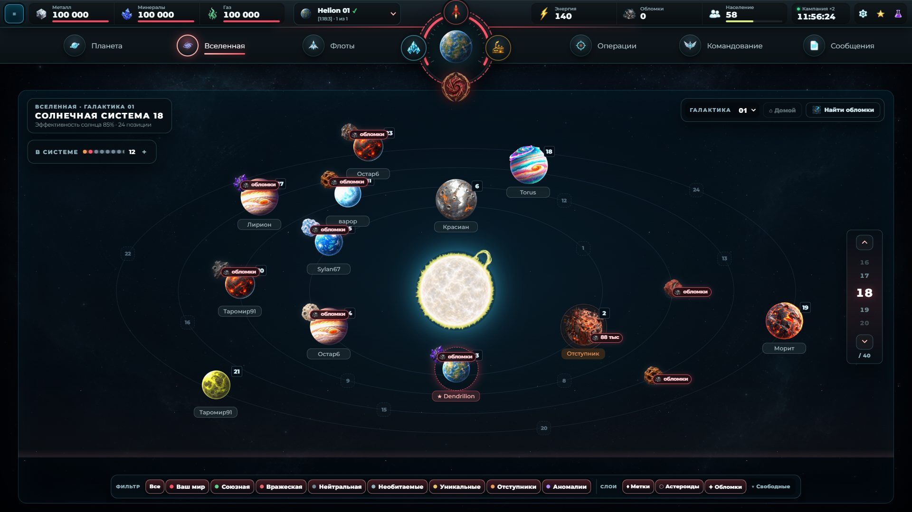
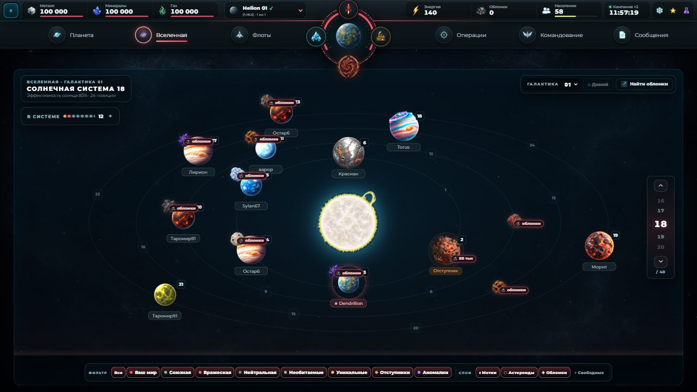
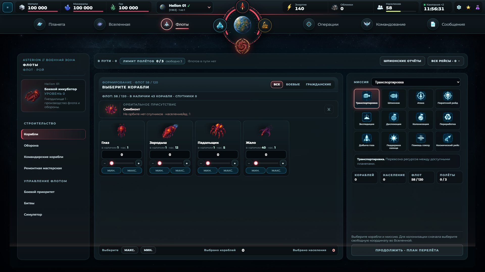
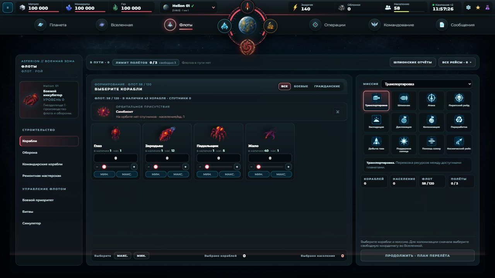
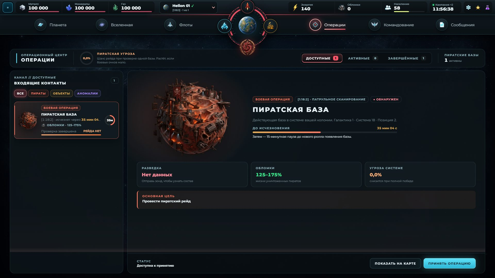
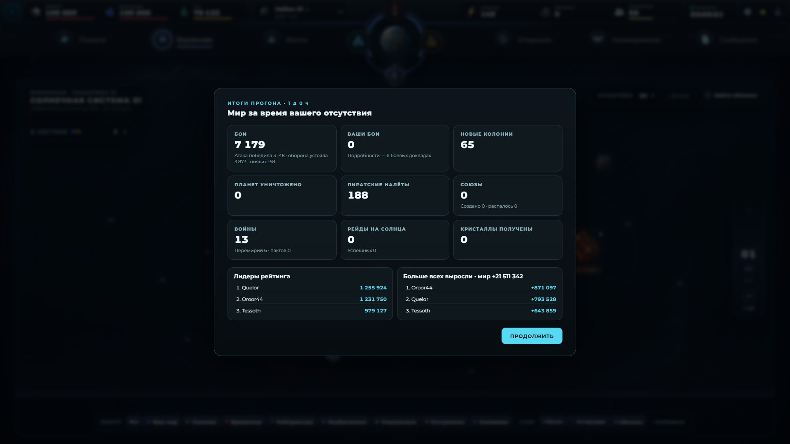

# Скорость интерфейса на позднем мире — 31.10.2026

PR 11, ветка `claude/ui-speed` (от main e9e54f5). Формат сохранения не меняется (без метки, patch).

## Коротко

- **Что тормозило.** При каждом переходе между разделами (любым: даже «Настройки») `RepairWorkshopPortal`
  перечитывал сохранение из хранилища — разбор, раскрытие компактных секций и миграция всего мира — одной
  длинной задачей UI-потока **до** того, как новый раздел мог отрисоваться. На мире дня 3 это 330 мс, на
  мире владельца 0,5–1,5 с. Это и есть «вкладка подсветилась, экран какое-то время пустой».
- **Починка.** Компоненты вне `App` (портал ремонтной мастерской, портал флотов, «Бои») берут мир, который
  `App` уже рисует (`getLiveSaveState`, `src/application/runtime.ts`), а хранилище читают только вне
  кампании. Плюс первое открытие «Вселенной»: поражения пиратов теперь группируются по системам один раз,
  а не перебираются целиком для каждой системы.
- **Итог (медиана «клик → раздел готов»).** Мир владельца: **475–831 мс → 11–76 мс**; мир дня 3:
  **347–431 мс → 9–70 мс**. Длинной задачи на каждом переходе больше нет; первый кадр раздела —
  в 1–5 кадрах после клика. Простой на разделах — ~60 FPS, отклик приказа «Построить» — 24–59 мс.
- Точность данных и детерминизм мира не затронуты: изменения — откуда взять уже посчитанный мир и
  кэширование чистой функции.

## Как мерили

`npm run test:late-game-fps-ui -- --fixture=<сохранение>` (`electron/late-game-fps-qa.cjs`), собранная
игра в Electron, GPU, Ryzen 5 5600. Новое: для каждого раздела шапки (Планета, Вселенная, Флоты, Операции,
Командование, Сообщения, Рейтинг, Настройки) — переход из другого раздела 3 раза при 1920×1080 и
1280×720:

- **первый кадр** — первый кадр анимации, в котором корень раздела есть в документе (кадр, который его рисует);
- **раздел готов** — последнее структурное изменение (добавлены/удалены элементы) перед 500 мс тишины:
  данные на экране;
- самая длинная задача UI-потока и самый длинный промежуток между кадрами за это время;
- кадры с пустой рабочей областью.

Плюс прежнее: FPS и длинные задачи при простое на каждом разделе (теперь и «Операции», «Настройки»),
отклик приказа «Построить» (3 нажатия). `--switch-only`, `--switch-profile=DIR` (профиль ЦП переходов),
`--shots=DIR`, `--max-switch-ready-ms=X`.

Миры:

- **копия сохранения владельца** от 31.10 11:55 (44,2 млн символов, схема 29; 100 NPC, 561 NPC-планета,
  ~4 400 флотов в полёте, «Быстрая»). Только чтение: копия лежит вне репозитория, путь передаётся
  `--fixture=`, QA работает в своём временном профиле;
- **`late-game-day-3.json`** (полный мир 100 NPC, день 3, 57,8 млн символов схемы 28).

«До» — та же сборка без изменений приложения (main e9e54f5 + новый замер).

## До / после

**Мир владельца, 1920×1080** — мс, медиана из 3 (худший):

| Раздел | до: раздел готов | после: первый кадр | после: раздел готов | до: самая длинная задача | после |
|---|---|---|---|---|---|
| Планета | 716 (1528) | 16 | 16 (16) | 1527 | — |
| Вселенная | 564 (1305) | 76 | 76 (568) | 1305 | 568 |
| Флоты | 594 (668) | 48 | 48 (119) | 668 | 119 |
| Операции | 633 (674) | 46 | 52 (97) | 664 | 83 |
| Командование | 831 (1329) | 15 | 15 (24) | 1328 | — |
| Сообщения | 522 (1072) | 19 | 19 (29) | 1064 | — |
| Рейтинг | 643 (766) | 37 | 37 (57) | 765 | 56 |
| Настройки | 531 (646) | 14 | 14 (672) | 646 | 672 |

**Мир владельца, 1280×720** — мс, медиана из 3 (худший):

| Раздел | до: раздел готов | после: первый кадр | после: раздел готов | до: самая длинная задача | после |
|---|---|---|---|---|---|
| Планета | 503 (730) | 15 | 15 (21) | 730 | — |
| Вселенная | 611 (1134) | 48 | 48 (95) | 611 | 95 |
| Флоты | 628 (683) | 40 | 40 (909) | 683 | 909 |
| Операции | 559 (574) | 31 | 36 (39) | 563 | — |
| Командование | 492 (506) | 11 | 11 (14) | 505 | — |
| Сообщения | 486 (500) | 19 | 19 (25) | 500 | — |
| Рейтинг | 510 (718) | 22 | 22 (27) | 717 | — |
| Настройки | 475 (492) | 17 | 17 (18) | 492 | — |

**Мир дня 3, 1920×1080** — мс, медиана из 3 (худший):

| Раздел | до: раздел готов | после: первый кадр | после: раздел готов | до: самая длинная задача | после |
|---|---|---|---|---|---|
| Планета | 377 (554) | 15 | 16 (160) | 554 | 72 |
| Вселенная | 394 (440) | 70 | 70 (150) | 439 | 150 |
| Флоты | 411 (446) | 43 | 43 (84) | 445 | 84 |
| Операции | 431 (487) | 34 | 44 (70) | 478 | 56 |
| Командование | 367 (393) | 16 | 16 (479) | 392 | — |
| Сообщения | 364 (403) | 18 | 18 (27) | 402 | — |
| Рейтинг | 383 (389) | 22 | 22 (44) | 388 | — |
| Настройки | 397 (407) | 15 | 15 (22) | 406 | — |

**Мир дня 3, 1280×720** — мс, медиана из 3 (худший):

| Раздел | до: раздел готов | после: первый кадр | после: раздел готов | до: самая длинная задача | после |
|---|---|---|---|---|---|
| Планета | 365 (373) | 12 | 12 (18) | 372 | — |
| Вселенная | 381 (509) | 44 | 44 (65) | 508 | 65 |
| Флоты | 364 (393) | 32 | 32 (35) | 393 | — |
| Операции | 372 (386) | 30 | 38 (62) | 381 | 54 |
| Командование | 352 (355) | 16 | 16 (18) | 354 | 389 |
| Сообщения | 354 (384) | 13 | 13 (18) | 384 | — |
| Рейтинг | 361 (425) | 15 | 15 (16) | 424 | — |
| Настройки | 347 (353) | 9,3 | 9,3 (9,4) | 352 | — |

**Мир владельца: простой на разделе (6 с), FPS / p95 кадра, мс / длинные задачи**

| Раздел | до | после |
|---|---|---|
| Планета | 60 / 17 / 0 | 60 / 17 / 0 |
| Вселенная | 59 / 17 / 1 | 55 / 17 / 6 |
| Флоты | 60 / 17 / 0 | 60 / 17 / 0 |
| Операции | 59 / 17 / 1 | 56 / 17 / 8 |
| Командование | 60 / 17 / 1 | 59 / 17 / 4 |
| Сообщения | 60 / 17 / 1 | 58 / 17 / 5 |
| Рейтинг | 60 / 17 / 1 | 60 / 17 / 0 |
| Настройки | 60 / 17 / 0 | 58 / 17 / 1 |

**Мир дня 3: простой на разделе (6 с), FPS / p95 кадра, мс / длинные задачи**

| Раздел | после |
|---|---|
| Планета | 53 / 17 / 2 |
| Вселенная | 59 / 17 / 1 |
| Флоты | 60 / 17 / 0 |
| Операции | 59 / 17 / 0 |
| Командование | 60 / 17 / 1 |
| Сообщения | 60 / 17 / 1 |
| Рейтинг | 60 / 17 / 1 |
| Настройки | 59 / 17 / 1 |

Худшие значения «после» (500–900 мс в одном из трёх переходов: Вселенная/Флоты/Настройки на мире
владельца, Командование на дне 3) — не переход, а совпавший с кликом тик живого мира (см. «Что осталось»):
они попадают в случайные разделы, а медиана и первый кадр в этих же сериях — десятки миллисекунд.

Отклик приказа «Построить» (закрытие окна и отрисовка): мир владельца 39–59 мс, день 3 — 24–43 мс
(первое нажатие на дне 3 — 171 мс, совпало с записью сохранения).

## Что именно тормозило

Профиль ЦП перехода в «Настройки» (самый лёгкий раздел, мир дня 3, `--switch-profile`): 335 мс из ~350
— пассивный эффект `RepairWorkshopPortal` → `persistence.read()` → `loadSavedState`: `migrateParsedSave`
153 мс, `decodeCompactSave` 76 мс, нормализация пиратов, шпионажа и пр. Эффект зависел от `route`
(чтобы найти, куда монтировать мастерскую), поэтому срабатывал на **каждом** переходе, а сам компонент и так
получает живое состояние событием `RUNTIME_STATE_CHANGED_EVENT`. Те же полные чтения были у портала
флотов и у «Боёв» при монтировании (у «Боёв» — ещё и отдельный `JSON.parse` всего сохранения ради истории
боёв).

После починки на мире владельца оставалось первое открытие «Вселенной» (~450–520 мс в первом из трёх
переходов): 188 мс в `applyPirateContactDefeatsToSchedules` — для каждой системы карты перебирался весь
список поражений пиратов мира. Теперь действительные поражения группируются по системам один раз на список
(кэш по ссылке, как уже кэшируются сдвинутые расписания); результат тот же.

## Что сделано

| Файл | Изменение |
|---|---|
| `src/application/runtime.ts` | `setLiveSaveState`/`getLiveSaveState`: мир, который рисует `App` (ставится на каждом рендере, сбрасывается при выходе из кампании) |
| `src/App.tsx` | ставит живой мир (2 строки) |
| `src/RepairWorkshopPortal.tsx`, `src/FleetWorkspacePortal.tsx` (1 строка), `src/BattleReportsView.tsx` | начальное состояние и пересинхронизация — из живого мира; хранилище — только вне кампании |
| `src/domain/pirates/contact-schedule.ts` | поражения пиратов по системам — один раз на список |
| `electron/late-game-fps-qa.cjs` | замер «клик → раздел готов», «Операции» и «Настройки», профили, скриншоты, бюджет CI |

На CI (`test:late-game-fps-ui`, шард с NPC-replay): свежая полная кампания (день 0) при программной
отрисовке — сохранений дня 3 и владельца на CI нет (фикстура дня 3 — десятки МБ и часы генерации). Бюджет
CI: медиана готовности раздела ≤ 300 мс (локально в той же конфигурации — 12–141 мс). Прогон в
конфигурации CI проходит.

## Скриншоты (с реального состояния, сразу после замеренного перехода)

Правки сохранения: нет. Копия сохранения владельца загружена как есть; часы страницы сдвинуты так, что
курсор мира — «сейчас» (без прогона отсутствия).

## Проверки

| Проверка | Результат |
|---|---|
| `npm run build` | проходит |
| `test:pirates`, `test:pirate-operations`, `test:universe`, `test:exploration`, `test:application` | 75 / 33 / 43 / 38 / 89 — все зелёные |
| `test:npc` | 181/181, 2 пропуска (30-дневные горизонты, как на main) |
| `test:late-game-fps-ui` — мир владельца, день 3, конфигурация CI | проходят (таблицы выше) |

## Что осталось

- **Тик живого мира на тяжёлых разделах.** На мире владельца «Вселенная» и «Операции» в некоторых прогонах
  перерисовываются на тиках живого мира по 60–120 мс (до 6–8 длинных задач за 6 с простоя, FPS 55–56; в
  других прогонах — ни одной). Это и даёт редкие худшие переходы. Следующий шаг — не пересчитывать на
  тике производные этих разделов, которые от тика не зависят (`selectExplorationTargets` ~74 мс,
  `selectPirateContacts` ~59 мс на мире владельца, карта системы).
- Вход в кампанию (загрузка сохранения владельца) — 2,9–3 с; в этом PR не менялся.
- Замер на CI идёт на свежем мире: регрессию вида «чтение сохранения на переходе» он поймает только в
  масштабе дня 0.
